::: {custom-style="Cover University"}
Universidad Cooperativa de Colombia
:::

::: {custom-style="Cover Faculty"}
Facultad de Ingeniería de Sistemas
:::

::: {custom-style="Cover Title"}
Diseño Arquitectónico y Estrategia DevOps del Sistema HotelSync
:::

::: {custom-style="Cover Subtitle"}
Documento de arquitectura AS-BUILT — versión 2.0
:::

::: {custom-style="Cover Body"}
Integrantes:\
Juan Diego Díaz\
Juan Pablo Hernández\
María Correa Soto\
Marleidys Bautista
:::

::: {custom-style="Cover Body"}
Materia: Arquitectura y Modelamiento de Software\
Código: 7835\
Profesor: Mauricio Antonio Ricardo Padilla
:::

::: {custom-style="Cover Date"}
30 de octubre de 2026
:::

```{=openxml}
<w:p><w:r><w:br w:type="page"/></w:r></w:p>
```

::: {custom-style="TOC Heading"}
Tabla de contenido
:::

```{=openxml}
<w:p><w:r><w:fldChar w:fldCharType="begin" w:dirty="true"/></w:r><w:r><w:instrText xml:space="preserve"> TOC \o "1-2" \h \z \u </w:instrText></w:r><w:r><w:fldChar w:fldCharType="separate"/></w:r><w:r><w:t>Actualice el campo en Word (F9) para generar la tabla de contenido.</w:t></w:r><w:r><w:fldChar w:fldCharType="end"/></w:r></w:p>
```


# Resumen ejecutivo

HotelSync es una plataforma de gestión hotelera multi-propiedad construida como un conjunto de once microservicios backend, un frontend Next.js que actúa también como BFF y once bases PostgreSQL independientes. El sistema cubre el ciclo completo de una estancia: catálogo de hoteles y habitaciones, disponibilidad y tarifas, reserva, pago, check-in, check-out, limpieza, facturación, puntos de fidelidad, integración con canales OTA y analítica de ingresos. La comunicación síncrona ocurre por HTTP con JWT y claves de servicio; la comunicación asíncrona usa el exchange `hotelsync.events` de RabbitMQ con patrón outbox.

Este documento es una fotografía **AS-BUILT**: describe lo que está implementado y desplegado al 30 de octubre de 2026, no un diseño ideal. El repositorio tiene 41 modelos Prisma distribuidos en once esquemas, 13 tipos de evento canónicos, nueve colas durables y 16 diagramas verificados. La versión 1.0 del documento (30 de agosto de 2026) describía nueve servicios, un API Gateway y un stack de observabilidad que nunca se implementaron; esta versión corrige esas afirmaciones y conserva el documento original sin modificarlo. **Actualización 2026-11-02:** se implementó un **API Gateway interno** (proxy sin estado, puerto 8080) detrás del BFF y el frontend enruta por él las diez familias de rutas; el BFF sigue siendo el único punto público y el dueño de Auth0. El stack de observabilidad (Prometheus/Grafana) sigue sin implementarse.

La arquitectura implementada tiene tres decisiones estructurales. Primera: **una base de datos por servicio**, sin claves foráneas ni joins entre bases; las referencias cruzadas son UUID lógicos. Segunda: **BFF en Next.js** como punto público único; los rewrites de `/api/*` inyectan el Bearer desde una cookie HttpOnly y evitan exponer el token a JavaScript. Desde 2026-11-02 esos rewrites apuntan a un **proxy interno** (`api-gateway`) que exige un secreto compartido, descarta cabeceras internas y reenvía a los servicios. Tercera: **consistencia eventual mediante outbox y RabbitMQ**, con idempotencia explícita en los consumidores y una saga durable para confirmar inventario en rate-availability.

La plataforma está desplegada en servicios gestionados: once web services de dominio más el api-gateway en Render (Oregon, plan gratuito), el frontend en Vercel, once proyectos Neon en `us-west-2`, RabbitMQ en CloudAMQP y Auth0 con Google como proveedor federado. La integración continua se resolvió con un workflow raíz para los servicios con base de datos y un workflow reutilizable `ci-v1` consumido por los once repositorios split; el informe del 27 de octubre registra 399 tests en 48 suites, todos en verde. El despliegue no lo ejecuta GitHub Actions: lo hacen las integraciones nativas de Render y Vercel al recibir un push a `main`.

El estado real incluye deuda que no debe ocultarse. Al 30 de octubre, la cuota mensual de CloudAMQP está agotada: los health checks de housekeeping y billing se cuelgan porque el broker reintenta la conexión sin límite, aunque sus APIs reales responden con 401 en menos de 0.6 segundos. El split de analytics desplegado todavía no aplica aislamiento por hotel, mientras que el monorepo ya contiene el arreglo sin commitear. No hay staging, observabilidad centralizada, rate limiting general, MFA ni circuit breaker. Estas brechas se documentan en la sección 14 con impacto, evidencia y siguiente acción.

El documento se organiza en quince secciones y siete anexos. La sección 3 presenta la vista general; la 4 cataloga los once servicios; la 5 documenta los modelos relacionales; la 6 explica eventos, colas y la secuencia de una reserva; la 7 cubre el frontend y el BFF; las secciones 8 a 10 describen DevOps, CI/CD y producción; las secciones 11 a 12 cubren seguridad y calidad; la 13 registra las decisiones arquitectónicas; la 14 expone el estado, las limitaciones y el roadmap; la 15 concluye. Los anexos contienen inventario de endpoints, catálogo de eventos, variables de entorno, enlaces de despliegue, evidencia de CI, runbook y glosario.

**Cómo leer este documento.** Cada afirmación relevante lleva una marca: **[I]** implementado y verificable en el repositorio o en producción; **[D]** diseñado o documentado pero no implementado; **[P]** pendiente o trabajo en curso. Las fechas y los archivos citados permiten reproducir la verificación. Cuando existe una diferencia entre el monorepo y un repositorio split, se indica explícitamente.

# 1. Introducción

## 1.1 Propósito

Este documento describe la arquitectura del sistema HotelSync tal como existe en el código y en el entorno de producción. Su propósito es triple: servir de base para la sustentación académica, facilitar el mantenimiento y la transferencia de conocimiento, y dejar un registro honesto de las decisiones, los riesgos y la deuda técnica. No es un manual de usuario ni una especificación de requisitos; los PRD y la guía de endpoints se citan como fuentes complementarias.

La pregunta que guía el documento no es "cómo debería estar construido HotelSync", sino "cómo está construido, por qué se llegó a esta forma y qué consecuencias tiene". Esa diferencia es importante: un documento de arquitectura que solo describe el ideal pierde valor para quien tiene que operar el sistema.

## 1.2 Alcance

El alcance incluye:

- Los once servicios backend: property, rate-availability, user, booking, front-desk, housekeeping, billing, channel-manager, loyalty, payment y analytics.
- El frontend Next.js 15 con portal público y panel `/admin`, incluido el BFF.
- Las once bases PostgreSQL y el esquema Prisma de cada servicio.
- La mensajería RabbitMQ, el patrón outbox y las colas durables.
- La integración continua en GitHub Actions y el despliegue en Render, Vercel, Neon, CloudAMQP y Auth0.
- El estado de producción, las limitaciones conocidas y el roadmap inmediato.

Quedan fuera del alcance: el detalle funcional de cada historia de usuario, los contratos completos de cada endpoint (ver `API.md`), la operación de la cuenta de Auth0 y los procedimientos internos de la universidad.

## 1.3 Audiencia

El documento está dirigido a estudiantes y docentes de la materia, a desarrolladores que se incorporan al proyecto y a cualquier revisor técnico que necesite verificar las afirmaciones. Se asume familiaridad con HTTP, bases de datos relacionales, TypeScript y conceptos básicos de mensajería. Los términos específicos se definen en el glosario (Anexo G).

## 1.4 Método y evidencia

La versión 2.0 se construyó con evidencia primaria, no con la memoria del equipo:

- Lectura de los once archivos `services/*/prisma/schema.prisma`, de las rutas Express y de los consumidores/outbox.
- Lectura de `docker-compose.yml`, `.github/workflows/ci.yml`, `.github/workflows/deploy.yml` y del workflow reutilizable documentado en `docs/INFORME-GITHUB-ACTIONS.md`.
- Consulta de `docs/HotelSync_Enlaces_Despliegue.md` para URLs, repositorios y bases Neon.
- Verificación en vivo de endpoints el 30 de octubre de 2026.
- Extracción de estilos y estructura del documento original `docs/HotelSync_Arquitectura.docx`.
- Generación automatizada de los diagramas ER desde Prisma con `docs/tools/er_from_prisma.py`, y render de los 16 diagramas con `docs/tools/render_diagrams.py`.

El código de referencia es el monorepo en el commit `3e85ea2` (21-oct-2026) más los cambios del árbol de trabajo al 30-oct-2026; esos cambios incluyen el arreglo de aislamiento por hotel en analytics y ajustes de UI que aún no se han commiteado. Los repositorios split pueden estar en commits distintos; cuando es relevante, se indica.

## 1.5 Convenciones

| Marca | Significado | Criterio de verificación |
|---|---|---|
| **[I]** | Implementado | Existe código ejecutable o recurso desplegado; se puede reproducir |
| **[D]** | Diseñado, no implementado | Hay documento, diagrama o intención, pero no código o despliegue |
| **[P]** | Pendiente | Trabajo identificado, sin diseño cerrado o sin implementación |
| **Monorepo** | Fuente de desarrollo | `C:\Workspaces\UCC\...\HOTELSYNC` |
| **Split** | Repositorio de entrega | `iI3lue/hotelsync-*`, uno por servicio |
| **Producción** | Entorno público | Render, Vercel, Neon, CloudAMQP y Auth0 |

Las cifras de tests corresponden al informe del 27-oct-2026 y a los workflows de los splits; no se ejecutó la suite completa durante la redacción porque varias pruebas requieren contenedores PostgreSQL y el entorno local no estaba levantado.

## 1.6 Relación con la versión 1.0

El documento original se conserva en `docs/HotelSync_Arquitectura.docx` y `docs/HotelSync_Arquitectura.pdf`, con fecha 30-ago-2026. Esta versión 2.0 no lo reescribe: lo reemplaza como fuente de verdad para el estado actual. Las diferencias principales son:

- Se documentan once servicios, no nueve: se incorporan payment y channel-manager.
- Se elimina el API Gateway **público** del diseño: el BFF de Next.js es el punto público. Desde 2026-11-02 existe un gateway interno (proxy sin estado) detrás del BFF, que no reemplaza al BFF ni mueve auth ni cookies.
- Redis se describe como caché opcional de rate-availability, no como componente obligatorio.
- Se reconoce que no hay Prometheus, Grafana, staging ni despliegue por Docker en producción.
- Se documentan los eventos, las colas y el outbox realmente implementados.
- Se registra el estado de producción con sus incidentes y brechas de seguridad.

# 2. Contexto y problemas

## 2.1 El dominio

Un hotel multi-propiedad necesita coordinar decisiones que pertenecen a áreas distintas: qué habitaciones están disponibles en una fecha, a qué precio, quién reservó, cómo paga, cuándo llega, cuándo se va, quién limpia, cuánto se factura y cuántos puntos gana el huésped. En un sistema monolítico, esas decisiones comparten una base de datos y una transacción; en microservicios, cada área es dueña de su estado y la coordinación se vuelve un problema de consistencia.

HotelSync resuelve esa coordinación con dos mecanismos. Las operaciones que necesitan una respuesta inmediata usan HTTP síncrono con timeout y claves de idempotencia (por ejemplo, reservar inventario al confirmar una reserva). Las operaciones que pueden tolerar latencia usan eventos: el check-out publica `checkout.completed` y housekeeping, billing y loyalty reaccionan cada uno a su ritmo. El sistema prioriza la consistencia eventual y la trazabilidad sobre la transacción distribuida.

## 2.2 Atributos de calidad

| Atributo | Requisito concreto | Mecanismo implementado |
|---|---|---|
| Consistencia de inventario | No vender dos veces la misma habitación | Transacción en R&A, reserva idempotente, saga durable en booking |
| Idempotencia | Reintentos del broker no duplican efectos | Outbox, claves de idempotencia, upserts, tablas de procesados |
| Disponibilidad | El fallo del broker no bloquea la reserva | Outbox `pending`, dispatcher separado, API sigue operando |
| Aislamiento por hotel | Un manager no ve datos de otro hotel | `requireHotelScope` y filtros por `hotel_id`; el split de analytics desplegado aún no lo aplica (§11.2) |
| Trazabilidad | Saber qué evento produjo cada cambio | Outbox con `event_id`, `event_type`, `payload`, `status`, `attempts` |
| Costo | Operar con free tiers académicos | Render free, Neon free, CloudAMQP free, Vercel hobby |
| Seguridad | No exponer tokens al navegador | Cookie HttpOnly, BFF, JWT verificado en cada servicio |

## 2.3 Restricciones del proyecto

El proyecto es académico y se desarrolló con recursos gratuitos. Esa restricción explica varias decisiones: once servicios en Render free se duermen a los 15 minutos y despiertan lento; CloudAMQP free tiene un límite mensual de mensajes; Neon free limita conexiones y almacenamiento; Vercel hobby impone timeouts. También explica lo que no se construyó: no hay Kubernetes, service mesh, staging ni observabilidad de pago. Documentar esas ausencias es parte de la arquitectura, porque condicionan el comportamiento real.

Otras restricciones fueron técnicas: Node.js 20, TypeScript estricto, Prisma, PostgreSQL 16, Next.js 15 con App Router y Tailwind. La elección de Prisma y Zod en los bordes buscó reducir errores de contrato y mantener un flujo uniforme entre servicios.

## 2.4 De nueve a once servicios

El diseño inicial contemplaba nueve servicios. Durante la implementación se separaron dos responsabilidades que estaban mezcladas:

- **payment-service** se separó de booking para aislar la pasarela simulada, las transacciones y los reembolsos. Booking conserva el estado del pago (`payment_status`) y reacciona a `payment.completed` y `payment.refunded`; no procesa tarjetas.
- **channel-manager-service** se separó para modelar canales OTA, reservas externas, inventario y tarifas por canal sin contaminar el núcleo de reservas. Consume eventos canónicos y expone un simulador de agencia.

La separación añadió dos bases de datos, dos despliegues y dos flujos asíncronos. El costo se aceptó porque permitió demostrar integración de canales y pagos como bounded contexts independientes, que es uno de los objetivos de la materia.

## 2.5 Lo que se decidió no construir

| Componente | Estado | Razón |
|---|---|---|
| API Gateway público | [D] descartado | El BFF de Next.js resuelve rewrites, cookies y autorización de UI con menos infraestructura |
| API Gateway interno (proxy) | [I] implementado 2026-11-02 | Enrutamiento y borde uniforme sin exponer otro servicio: vive detrás del BFF y exige secreto compartido |
| Kubernetes / service mesh | [D] descartado | Inviable en free tier y sin necesidad operativa para once servicios |
| Prometheus + Grafana | [D] descartado | Se usan logs de Render/Vercel; no hay métricas históricas |
| Staging | [D] descartado | Un solo entorno; los splits despliegan desde `main` |
| Redis obligatorio | [I] opcional | rate-availability funciona sin Redis; se usa como caché si `REDIS_URL` existe |
| MFA | [P] | Auth0 lo soporta, pero no se configuró |
| Rate limiting global | [P] | user-service limita forgot/code/reset en memoria; no hay límite por IP/usuario en el resto |
| Circuit breaker | [P] | Los clientes HTTP usan timeouts y reintentos acotados, no un breaker formal |

# 3. Arquitectura general

## 3.1 Vista de contexto y contenedores

La Figura 1 muestra la arquitectura lógica implementada. El navegador habla con el frontend Next.js en Vercel; el frontend sirve el portal público y el panel `/admin`, aplica un middleware de sesión/rol y reescribe `/api/*` hacia los servicios. El BFF inyecta el Bearer desde la cookie HttpOnly `hs_access`. Los servicios de dominio corren en Render, cada uno con su base PostgreSQL en Neon. RabbitMQ transporta eventos; Redis es una caché opcional de rate-availability. Auth0 y Google se usan para identidad federada, pero el token de sesión lo emite user-service.

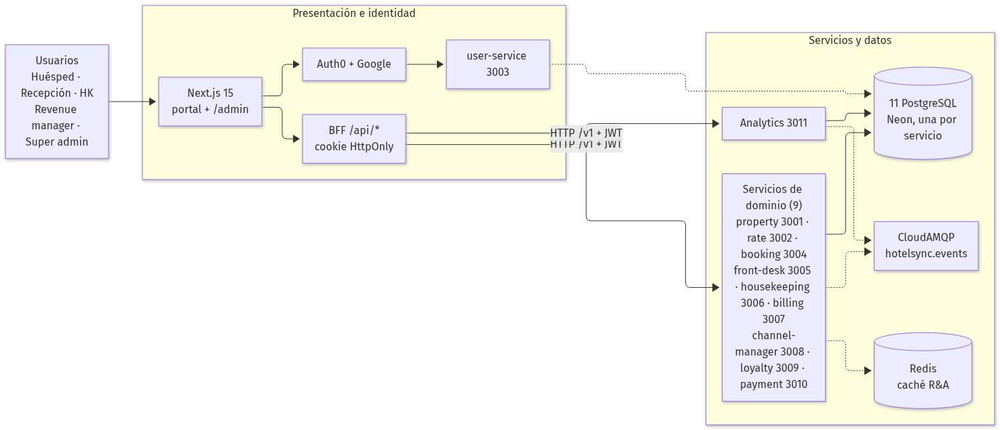{width=6.2in}

La figura es una vista de contenedores, no de despliegue. No muestra réplicas, balanceadores ni zonas de disponibilidad porque el despliegue real no los tiene: cada servicio es una instancia única en Render free. La topología de producción se detalla en la Figura 16.

## 3.2 Principios estructurales

**Base de datos por servicio.** Cada servicio tiene su propio esquema Prisma, su propia `DATABASE_URL` y su propio proyecto Neon. No hay claves foráneas entre bases ni joins cross-database. Las referencias entre contextos son UUID almacenados como columnas normales: `booking.hotel_id`, `booking.room_type_id`, `folio.hotel_id`, `payment.booking_id`. La integridad referencial se mantiene por contrato y por validación en el borde, no por el motor.

**Flujo Route → Controller → Service.** Todas las APIs Express siguen el mismo orden: la ruta declara método, path, middlewares de autenticación/validación y controller; el controller traduce HTTP a una llamada de servicio; el servicio contiene la lógica y habla con Prisma. Los errores se lanzan como `AppError(status, message, code)` y un error handler común devuelve `{ error, message, statusCode }` sin filtrar detalles internos.

**Validación en el borde con Zod.** Cada endpoint valida body, params o query con un esquema Zod antes de llegar al controller. Los esquemas viven en `src/validators/` y se reutilizan en los tests. Esto reduce la superficie de datos inválidos y documenta el contrato.

**JWT verificado localmente.** user-service emite un JWT HS256 con `sub` (el id del usuario), `role`, `hotel_id` y `scope`. Cada servicio verifica la firma con `AUTH_JWT_SECRET`; no hay introspección central ni llamada a user-service por request. La seguridad depende de que el secreto sea idéntico en todos los servicios y de que nunca se filtre.

**Outbox transaccional.** Los servicios que publican eventos escriben el evento en su tabla `EventOutbox` dentro de la misma transacción que cambia el estado. Un dispatcher periódico lee `pending`, publica en RabbitMQ con publisher confirms y marca `sent`. Si el broker está caído, el evento queda `pending` y la operación de negocio no se pierde.

**Idempotencia.** Los consumidores usan claves naturales o tablas de procesados: `booking_id` único en arrivals, folios y puntos; `(booking_id, type)` en loyalty; `ProcessedEvent` y `AppliedKey` en rate-availability; `InventoryReservationAttempt` en booking. Un replay del broker no duplica cargos, puntos ni tareas.

**Concurrencia optimista.** Booking usa un campo `version`. Confirmar o cancelar envía la versión esperada; si otro proceso la cambió, el servicio devuelve 409 y el cliente debe releer. Esto evita lost updates en un recurso que varios actores pueden tocar.

**Aislamiento por hotel.** Los roles `MANAGER`, `RECEPTIONIST` y `HOUSEKEEPER` llevan `hotel_id` en el token. Los servicios filtran por ese valor y rechazan accesos cruzados. `SUPER_ADMIN` tiene visión global. Analytics aplica `requireHotelScope` además del rol.

## 3.3 Flujo de una operación

Una reserva típica ilustra el flujo completo. El huésped crea una reserva en estado `pending`; booking valida disponibilidad y precio contra rate-availability, pero no compromete inventario todavía. Al pagar, payment registra la transacción y publica `payment.completed`. Booking consume el evento, confirma la reserva y, en la misma operación, reserva inventario en rate-availability con una clave de idempotencia. Si la reserva de inventario falla por falta de stock, booking registra el pago igual y deja una saga pendiente; un reconciliador cada 15 segundos reintenta la confirmación con la misma clave. Cuando la reserva queda confirmada, booking publica `booking.confirmed`; front-desk crea la llegada, billing abre el folio y channel-manager sincroniza el canal. En el check-out, front-desk publica `checkout.completed` y `booking.completed`; housekeeping marca la habitación sucia y crea la tarea, billing cierra el folio y emite la factura, y loyalty acredita o revierte puntos según corresponda.

La secuencia completa, con actores y eventos, se muestra en la Figura 14.

## 3.4 Lo que no existe en la arquitectura

Es tan importante decir qué hay como decir qué no hay. Al 30-oct-2026:

- **No hay API Gateway público.** El frontend Next.js hace de BFF con rewrites. No hay Kong, NGINX, Traefik ni Envoy. Desde 2026-11-02 sí hay un **gateway interno** (proxy Express sin estado) entre el BFF y los servicios: no es público, no maneja sesiones y solo acepta llamadas con `x-gateway-secret`.
- **No hay service discovery.** Las URLs de los servicios se inyectan por variables de entorno; no hay registro ni balanceo.
- **No hay staging.** Render y Vercel despliegan desde `main`; no hay un entorno intermedio con datos separados.
- **No hay observabilidad centralizada.** No hay Prometheus, Grafana, OpenTelemetry, Sentry ni agregación de logs. Se usan los logs de Render y Vercel.
- **No hay rate limiting general, WAF ni MFA.** La autenticación es JWT + Auth0; user-service limita en memoria forgot/code/reset, pero login y registro no tienen límite, y no hay segundo factor.
- **No hay circuit breaker.** Los clientes HTTP usan timeouts y reintentos acotados; no hay un patrón breaker formal.
- **No hay Docker en producción.** El `docker-compose.yml` es para desarrollo local; Render ejecuta Node.js nativo.
- **No hay transacciones distribuidas.** La consistencia es eventual; no hay two-phase commit ni sagas orquestadas centralmente.

Estas ausencias no son necesariamente fallas para un proyecto académico, pero deben explicarse: cambian el comportamiento esperado y el riesgo operativo.

## 3.5 Por qué BFF y no API Gateway

Un API Gateway centralizaría autenticación, rate limiting, enrutamiento y observabilidad. El equipo eligió el BFF de Next.js por tres razones. Primera: el frontend ya necesita un servidor para Auth0 (intercambio de código, cookies HttpOnly, refresh) y para ocultar claves de servicio como `CHANNEL_MANAGER_SIMULATOR_KEY`. Segunda: los rewrites de Next permiten mapear `/api/property/*` a `http://property-service:3001/v1/*` sin infraestructura adicional. Tercera: el middleware puede proteger rutas `/admin` por rol antes de renderizar, lo que mejora la experiencia y evita parpadeos.

El costo es que el BFF no es un gateway completo: no hace rate limiting global, no agrega métricas, no balancea, no aplica políticas uniformes a todos los servicios y no puede renovar el token en el rewrite (las cookies seteadas sobre `NextResponse.next()` se pierden). La renovación se movió a `/api/auth/refresh`, `/api/auth/me` y al retry del cliente. Esta es una decisión consciente con tradeoffs, no una omisión.

**Actualización 2026-11-02.** Se agregó un gateway interno como proxy (Express, sin estado): exige `x-gateway-secret` (salvo `/health`), descarta `cookie`, `x-service-key`, `x-loyalty-key`, `x-provider-key` y `x-internal-*`, regenera `x-request-id`, propaga la IP real del cliente y enruta por una tabla declarativa de once prefijos. No hace autenticación (cada servicio valida el JWT), no hace rate limiting distribuido y no expone métricas: solo uniforma el borde y centraliza el enrutamiento y los logs. El BFF conserva cookies, Auth0 y la autorización de UI; `GATEWAY_SERVICES=""` devuelve todo el tráfico a destinos directos.

Además, el gateway **despierta los servicios free** de Render: el primer request autenticado dispara en segundo plano un `GET /health` a los once upstreams (ventana `WAKE_ALL_INTERVAL_MS`, 30 min), porque con la instancia dormida el edge de Render responde 502 en decenas de milisegundos. El front reintenta los GET ante 502/503/504 (3 intentos, 1 s/3 s/7 s) para cubrir el request que dispara el despertar.

## 3.6 Tradeoffs principales

| Decisión | Beneficio | Costo | Mitigación |
|---|---|---|---|
| Once servicios y once DB | Aislamiento, despliegue independiente, demostración de bounded contexts | Complejidad operativa, latencia, más secrets | Contratos claros, CI por servicio, BFF |
| Consistencia eventual | Desacople y resiliencia | Ventanas de inconsistencia | Outbox, idempotencia, reconciliador |
| Free tiers | Costo cero | Cold starts, cuotas, sleeps | Warmup, timeouts, reintentos |
| JWT local | Baja latencia, sin acoplamiento runtime | Rotación de secreto manual | Secreto compartido, rotación planificada |
| BFF | Menos infraestructura, cookies seguras | No es gateway completo | Documentar límites, agregar rate limit [P] |
| Sin staging | Menos costo | Riesgo de romper producción | CI, pruebas, despliegue gradual [P] |

# 4. Catálogo de servicios

Los once servicios comparten la misma estructura: `src/routes`, `src/controllers`, `src/services`, `src/validators`, `src/middleware`, `prisma/schema.prisma`, `prisma/migrations`, `tests/`. Todos exponen `GET /health`. Las fichas siguientes resumen propósito, puerto, base, modelos, endpoints principales, eventos y dependencias. Los paths se muestran sin el prefijo `/v1`, que todos usan salvo health.

## 4.1 Property Service

**Propósito.** Es el catálogo maestro de hoteles, tipos de habitación, políticas de cancelación y habitaciones físicas. Propiedad de los datos de referencia que otros servicios copian como UUID.

**Ficha.** Puerto 3001; base `property_db` (Neon `hotelsync-property-db`); modelos `Hotel`, `RoomType`, `CancellationPolicy`, `PhysicalRoom`, `EventOutbox`; 5 modelos. Endpoints: `GET/POST /hotels`, `GET/PUT /hotels/:id`, `GET /hotels/:id/room-types`, `GET /hotels/:id/cancellation-policy`, `GET/POST /hotels/:hotelId/rooms`, `GET/POST/PUT /room-types`, `GET/POST /cancellation-policies`. Eventos: publica `physical-room.created` cuando se crea una habitación física. Dependencias: ninguna síncrona obligatoria; es consumido por el frontend y por analytics (réplica de lectura).

**Notas de implementación.** Las lecturas de hoteles y tipos son públicas. El alta de habitación física exige `requireHotelManager`, pero las escrituras de hoteles, tipos de habitación y políticas de cancelación no aplican `requireRole`; `POST /cancellation-policies` ni siquiera exige autenticación. La brecha está documentada en §11.2. El seed carga hoteles y habitaciones de demostración. `PhysicalRoom` es la fuente de verdad de números de habitación; housekeeping y front-desk usan esos números, no los inventan.

## 4.2 Rate & Availability Service

**Propósito.** Administra inventario por tipo de habitación y fecha, tarifas, reglas de precio y bloqueos. Es el árbitro de la disponibilidad y el precio.

**Ficha.** Puerto 3002; base `rate_availability_db`; modelos `Inventory`, `Rate`, `RateRule`, `ProcessedEvent`, `AppliedKey`, `EventOutbox`; 6 modelos. Endpoints: `PUT /availability/inventory`, `GET /availability`, `GET /availability/range`, `POST /availability/reserve`, `POST /availability/release`, `GET/POST /rates`, `PUT/GET /rate-rules`, `POST /blocks`. Eventos: publica `availability.updated` y `rate.updated`; consume `physical-room.created`. Dependencias: Redis opcional (`REDIS_URL`); no llama a otros servicios.

**Notas de implementación.** `reserve` y `release` son server-to-server y exigen `x-service-key`. La reserva usa una transacción con bloqueo y una clave de idempotencia; repetir la misma clave no descuenta dos veces. `ProcessedEvent` y `AppliedKey` registran eventos y operaciones ya aplicadas. La caché de disponibilidad y tarifas es lazy: si Redis no está configurado o falla, el servicio sigue funcionando contra PostgreSQL. Las reglas de tarifa aplican multiplicadores por rango de fechas y estancia mínima; el precio final se calcula en el servicio, no en el frontend.

## 4.3 User Service

**Propósito.** Es el proveedor de identidad y autorización. Gestiona cuentas, login local, login federado con Auth0/Google, refresh tokens, recuperación de contraseña y personal por hotel.

**Ficha.** Puerto 3003; base `user_db`; modelos `User`, `PasswordResetToken`, `RoleAssignment`, `ExternalIdentity`, `RefreshSession`; 5 modelos. Endpoints: `POST /auth/register`, `POST /auth/login`, `POST /auth/refresh`, `POST /auth/logout`, `POST /auth/federated`, `POST /auth/password/forgot|reset|code`, `GET /users/me`, `PATCH /users/me`, `GET /users/:id`, `POST/DELETE /users/:id/...` (baja y reactivación), `GET/POST/PATCH /admin/...`, `GET/POST/PATCH /hotels/:hotelId/staff`. Eventos: no publica eventos canónicos. Dependencias: Auth0 (OIDC), booking-service (verificar reservas activas antes de una baja), loyalty-service (consultar puntos en el perfil).

**Notas de implementación.** Los roles son `GUEST`, `RECEPTIONIST`, `HOUSEKEEPER`, `MANAGER` y `SUPER_ADMIN`. Un `MANAGER` solo puede crear `RECEPTIONIST` y `HOUSEKEEPER` en su hotel; `SUPER_ADMIN` puede crear cualquier rol. El refresh token rota y se persiste hasheado en `RefreshSession`; el logout lo revoca. La recuperación de contraseña usa códigos con expiración y, en modo demo, un código visible. El consentimiento de tratamiento de datos (Ley 1581) se registra con `terms_accepted_at`. El login federado exige `nonce` y vincula `ExternalIdentity` sin fusionar cuentas por email.

## 4.4 Booking Service

**Propósito.** Es el agregado central de la reserva. Orquesta la creación, confirmación, cancelación, el estado de pago y la relación con inventario, pagos y canales.

**Ficha.** Puerto 3004; base `booking_db`; modelos `Booking`, `InventoryReservationAttempt`, `EventOutbox`; 3 modelos. Endpoints: `GET/POST /bookings`, `GET /bookings/me`, `GET /bookings/:id`, `POST /bookings/:id/confirm`, `POST /bookings/:id/cancel`, `GET /bookings/by-user/:userId/has-active`. Eventos: publica `booking.created`, `booking.confirmed`, `booking.cancelled`, `booking.paid`; consume `payment.completed` y `payment.refunded`. Dependencias: rate-availability (reserve/release), payment (checkout), user (perfil), loyalty (puntos en detalle), channel-manager (reservas OTA).

**Notas de implementación.** La creación deja la reserva `pending` y emite `booking.created`; no compromete inventario. La confirmación usa `version` optimista y llama a `reserve` con una clave de idempotencia; si no hay stock, devuelve 409 y cancela la reserva. La cancelación libera inventario si estaba confirmada y emite `booking.cancelled`. El consumidor de pagos es idempotente: si la reserva ya está `PAID`, no hace nada; si está `pending`, confirma; si está cancelada, ignora. `InventoryReservationAttempt` es un checkpoint durable para la saga; `startConfirmationReconciler` lo reintenta cada 15 segundos. El acceso a una reserva se permite por JWT del dueño, por `manage_token` (hash) o por rol de staff con alcance de hotel.

## 4.5 Front Desk Service

**Propósito.** Es el read model operativo de llegadas y el dueño del check-in, check-out, asignación de habitación e incidencias.

**Ficha.** Puerto 3005; base `front_desk_db`; modelos `RoomAssignment`, `Arrival`, `EventOutbox`, `GuestIncident`; 4 modelos. Endpoints: `GET /arrivals`, `POST /check-in`, `GET /check-in/:bookingId`, `POST /check-out`, `GET/POST/PATCH /incidents`. Eventos: consume `booking.confirmed` y `booking.cancelled`; publica `checkout.completed` y `booking.completed`. Dependencias: booking-service (detalle de reserva, estado y pago).

**Notas de implementación.** `Arrival` tiene `booking_id` como PK y se crea por upsert al recibir `booking.confirmed`; `booking.created` se ignora porque una reserva pendiente no debe aparecer en llegadas. El check-in exige que la reserva esté `confirmed` y que el pago esté resuelto según la preferencia (`ONLINE` pagado o `RECEPTION` autorizado); si no, devuelve 409. No se puede hacer check-in dos veces: `RoomAssignment.booking_id` es único. El check-out marca `checked_out_at`, libera la habitación y publica los dos eventos en la misma transacción de outbox. Las incidencias son texto libre con estado `open`/`closed` y se consultan por hotel.

## 4.6 Housekeeping Service

**Propósito.** Gestiona el estado de limpieza de las habitaciones físicas y las tareas de limpieza derivadas de un check-out.

**Ficha.** Puerto 3006; base `housekeeping_db`; modelos `RoomStatus`, `CleaningHistory`; 2 modelos. Endpoints: `GET /rooms/status`, `PUT /rooms/:id/status`, `GET /tasks`, `GET /tasks/mine`, `PUT /tasks/:id/assign`, `PUT /tasks/:id/start`, `PUT /tasks/:id/complete`. Eventos: consume `checkout.completed`; no publica eventos canónicos. Dependencias: booking-service (para obtener `hotel_id` a partir de `booking_id`).

**Notas de implementación.** Los estados de habitación son `dirty`, `cleaning`, `clean` y `maintenance`. Los estados de tarea son `pending`, `assigned`, `in_progress`, `done` y `cancelled`. Al recibir `checkout.completed`, el consumidor obtiene la reserva, hace upsert de `RoomStatus` en `dirty` y crea `CleaningHistory` con `booking_id` único; si el booking no existe, lanza un error para que el broker reencole. La asignación y el inicio de la tarea actualizan el estado de la habitación a `cleaning`; completar la deja `clean`. Un `HOUSEKEEPER` solo ve sus tareas y las de su hotel.

## 4.7 Billing Service

**Propósito.** Administra folios, cargos y facturas. Abre el folio cuando la reserva se confirma y lo cierra en el check-out.

**Ficha.** Puerto 3007; base `billing_db`; modelos `Folio`, `Charge`, `Invoice`, `EventOutbox`; 4 modelos. Endpoints: `GET /folios`, `GET /folios/guest/:id`, `GET /folios/by-booking/:bookingId`, `GET /folios/:id`, `POST /folios/:id/close`, `POST /charges`, `GET /invoices`, `GET /invoices/:id`. Eventos: consume `booking.confirmed` y `checkout.completed`; publica `folio.closed` (sin consumidor al 30-oct). Dependencias: booking-service (datos de la reserva), property-service (moneda/impuestos si aplica).

**Notas de implementación.** `openFolio(bookingId)` crea un folio `open` con un cargo `room` calculado a partir de la reserva; es idempotente por `booking_id`. `closeFolioByBooking` cierra el folio, calcula el total y crea una `Invoice` con número `F-<primeros 8 chars del folio>`; si ya existe factura, retorna la existente. Los cargos adicionales usan categorías `room`, `minibar`, `restaurant`, `other`. El cierre manual `POST /folios/:id/close` existe para recepción; el cierre automático ocurre por evento. La moneda por defecto es COP, configurable con `DEFAULT_CURRENCY`.

## 4.8 Payment Service

**Propósito.** Simula una pasarela de pago, registra transacciones y gestiona reembolsos. No almacena datos de tarjeta.

**Ficha.** Puerto 3010; base `payment_db`; modelos `PaymentTransaction`, `EventOutbox`; 2 modelos. Endpoints: `POST /checkout`, `GET /checkout/:bookingId`, `POST /admin/payments`, `GET /admin/payments/:bookingId`. Eventos: publica `payment.completed` y `payment.refunded`; consume `booking.cancelled`. Dependencias: booking-service (verificar reserva y monto), `BOOKING_SERVICE_KEY`.

**Notas de implementación.** El checkout valida la reserva, evita duplicados por `booking_id` y crea una transacción en `PROCESSING`; la simulación decide `COMPLETED` o `FAILED` y, si se completa, emite `payment.completed` en la misma transacción. Los estados son `PROCESSING`, `COMPLETED`, `FAILED` y `REFUNDED`. El consumidor de `booking.cancelled` busca una transacción completada y la reembolsa; si el pago aún no se completó, marca la intención y el reembolso queda agendado. El registro manual de recepción permite cobrar en el hotel y consultar el estado por reserva. La moneda por defecto es COP.

## 4.9 Loyalty Service

**Propósito.** Administra cuentas de fidelidad, puntos y niveles. Acredita puntos cuando una reserva se paga y los revierte si se cancela.

**Ficha.** Puerto 3009; base `loyalty_db`; modelos `LoyaltyAccount`, `PointsTransaction`, `EventOutbox`; 3 modelos. Endpoints: `GET /levels`, `GET /me`, `GET /me/bookings/:bookingId/points`, `POST /me/redeem`, `GET /admin/users/:userId/loyalty`, `POST /admin/points`. Eventos: consume `payment.completed`, `booking.completed` y `booking.cancelled`; no publica eventos. Dependencias: booking-service (detalle y monto), user-service (usuario activo).

**Notas de implementación.** Los niveles son `silver` (0-999 puntos, multiplicador 1.0), `gold` (1000-4999, 1.25) y `platinum` (5000+, 1.50). `processEarn` es idempotente por `(booking_id, type="earn")`; acredita `floor(total_amount * multiplicador)` y sube de nivel si corresponde, sin bajar automáticamente por gasto. `processReversal` es idempotente por `(booking_id, type="reverse")`, revierte como máximo lo que el huésped aún tiene y recalcula el nivel (puede bajar). `booking.completed` se usa como respaldo idempotente de `payment.completed`; si la reserva ya fue cancelada, no acredita. El canje descuenta puntos y registra `type="redeem"`. El modelo `EventOutbox` existe en el esquema pero no se usa para publicar eventos.

## 4.10 Channel Manager Service

**Propósito.** Modela canales OTA, reservas externas y snapshots de inventario/tarifa por canal. Expone un simulador para demostrar la ingesta de una agencia.

**Ficha.** Puerto 3008; base `channel_manager_db`; modelos `Channel`, `ExternalReservation`, `ChannelInventory`, `ChannelRate`; 4 modelos. Endpoints: `POST /simulator/:channel/reservations`, `GET /simulator/:channel/state`. Eventos: consume `booking.created`, `booking.confirmed`, `booking.cancelled`, `availability.updated` y `rate.updated`; no publica eventos canónicos. Dependencias: booking-service (crear reserva OTA), rate-availability (leer disponibilidad/tarifas), `CHANNEL_MANAGER_SERVICE_KEY`, `CHANNEL_MANAGER_SIMULATOR_KEY`.

**Notas de implementación.** El simulador exige `x-provider-key`; el frontend nunca ve esa clave porque la ruta Next `/api/simulator/reservations` la inyecta del lado servidor y exige `SUPER_ADMIN`. La ingesta crea una `ExternalReservation` y llama a booking con `channel` y `external_id`; booking aplica idempotencia por `(channel, channel_external_id)`. El consumidor ignora `booking.created` (pending) y actualiza el estado de la reserva externa en `booking.confirmed`/`booking.cancelled`; también guarda snapshots de `availability.updated` y `rate.updated` para el estado del canal. No hay integración real con Booking.com ni Expedia: el canal `simulado` es una demostración.

## 4.11 Analytics Service

**Propósito.** Calcula ocupación, ADR, RevPAR y previsión a partir de réplicas de lectura de booking y property. Sirve el dashboard de revenue management.

**Ficha.** Puerto 3011; base `analytics_db`; modelos `OccupancyDaily`, `KpiByProperty`, `EventOutbox`; 3 modelos. Endpoints: `GET /dashboard/:hotelId`, `GET /occupancy`, `GET /adr`, `GET /revpar`, `GET /forecast`. Eventos: publica `metrics.updated`; no consume eventos. Dependencias: `DATABASE_URL_BOOKING` y `DATABASE_URL_PROPERTY` (read-only), scheduler interno.

**Notas de implementación.** El ETL corre al arranque (con delay de 30 s) y cada 6 horas; el rango por defecto es `[hoy - 7 días, hoy)` (30 días en producción), con `to` exclusivo. También se puede ejecutar manualmente con `node dist/jobs/etl.js --from=YYYY-MM-DD --to=YYYY-MM-DD`. El ETL lee reservas confirmadas y capacidad física, calcula por hotel-día y hace upsert por `(hotel_id, date)`; los endpoints leen solo las tablas agregadas, nunca las réplicas en vivo. `metrics.updated` se emite por hotel-día en la misma transacción que el upsert. El dashboard exige `MANAGER` o `SUPER_ADMIN` y `requireHotelScope`; un manager solo ve su hotel en el monorepo. En el split desplegado al 30-oct ese filtro no está aplicado; la brecha se documenta en §11.2. Las queries crudas castean `date` a `::text` para evitar desfases de zona horaria. Si un hotel tiene reservas pero cero habitaciones físicas, el ETL avisa y deja occupancy/RevPAR en 0; el ADR sigue siendo válido.

## 4.12 Matriz de servicios

| Servicio | Puerto | Base | Modelos | Publica | Consume |
|---|---|---:|---|---|---|
| property | 3001 | property_db | 5 | physical-room.created | — |
| rate-availability | 3002 | rate_availability_db | 6 | availability.updated, rate.updated | physical-room.created |
| user | 3003 | user_db | 5 | — | — |
| booking | 3004 | booking_db | 3 | booking.created, confirmed, cancelled, paid | payment.completed, payment.refunded |
| front-desk | 3005 | front_desk_db | 4 | checkout.completed, booking.completed | booking.confirmed, booking.cancelled |
| housekeeping | 3006 | housekeeping_db | 2 | — | checkout.completed |
| billing | 3007 | billing_db | 4 | folio.closed | booking.confirmed, checkout.completed |
| payment | 3010 | payment_db | 2 | payment.completed, payment.refunded | booking.cancelled |
| loyalty | 3009 | loyalty_db | 3 | — | payment.completed, booking.completed, booking.cancelled |
| channel-manager | 3008 | channel_manager_db | 4 | — | booking.created/confirmed/cancelled, availability.updated, rate.updated |
| analytics | 3011 | analytics_db | 3 | metrics.updated | — |

## 4.13 Lectura de la matriz

La matriz confirma una topología de hubs y hojas. booking, payment y front-desk concentran la coreografía: booking publica cuatro eventos y consume los dos de payment; payment consume la cancelación; front-desk consume confirmación/cancelación y publica `checkout.completed` y `booking.completed`. Son los tres servicios con mayor fan-out y los candidatos naturales a observabilidad y contratos de eventos explícitos.

Alrededor de ese eje, property y rate-availability forman la cadena de inventario; housekeeping, billing y loyalty son consumidores terminales del check-out; channel-manager es una hoja de integración que no publica al exchange; analytics se alimenta de réplicas y publica `metrics.updated` sin consumidor. user-service queda fuera del grafo y property solo publica: la identidad se verifica por JWT y property se consulta por HTTP o réplica. En conjunto, siete servicios publican y ocho consumen, pero el acoplamiento real se concentra en booking, payment y front-desk.

# 5. Modelo de datos

## 5.1 Estrategia de persistencia

Cada servicio tiene un esquema Prisma independiente y una base PostgreSQL propia. Al 30-oct-2026 hay **41 modelos** repartidos así: property 5, rate-availability 6, booking 3, user 5, front-desk 4, housekeeping 2, billing 4, payment 2, loyalty 3, channel-manager 4 y analytics 3. Siete servicios incluyen una tabla `EventOutbox` que es infraestructura de mensajería, no una entidad de dominio.

Las reglas de modelado son uniformes:

- Claves primarias UUID (`@default(uuid())`) salvo claves compuestas naturales en tablas de agregación y proyecciones.
- Timestamps con zona horaria (`Timestamptz(6)`), salvo fechas de calendario (`@db.Date`).
- Dinero en `Decimal(10,2)`; nunca `Float`.
- Sin claves foráneas entre servicios. Las columnas `hotel_id`, `room_type_id`, `booking_id`, `user_id` y `guest_id` son UUID lógicos.
- Dentro de un servicio sí hay relaciones Prisma y claves foráneas reales (por ejemplo, `Charge.folio_id` → `Folio`).
- Migraciones versionadas en `prisma/migrations`; seeds por servicio para datos de demostración.
- Nombres de tabla en snake_case con `@@map`; nombres de campo en snake_case.

La integridad entre contextos se mantiene por tres vías: validación en el borde, claves de idempotencia y eventos. No hay una transacción que abarque dos bases; cuando una operación necesita coordinar dos servicios, se usa una saga con checkpoint (booking → rate-availability) o consistencia eventual (checkout → housekeeping/billing/loyalty).

## 5.2 Propiedad de los datos

| Dato | Servicio dueño | Copias o read models | Regla |
|---|---|---|---|
| Hotel, tipo de habitación, política, habitación física | property | analytics (réplica), booking (UUID) | Property es la fuente; los demás no editan |
| Inventario, tarifa, regla, bloqueo | rate-availability | channel-manager (snapshot) | R&A es el árbitro; los snapshots son proyecciones |
| Reserva y estado de pago | booking | front-desk (Arrival), billing (Folio), payment (transacción) | Booking es la fuente del ciclo de la reserva |
| Transacción de pago | payment | booking (`payment_status`, `payment_transaction_id`) | Payment es la fuente del cobro |
| Llegada, asignación, incidencia | front-desk | — | Front-desk es la fuente operativa |
| Estado de habitación y tarea | housekeeping | — | Housekeeping es la fuente de limpieza |
| Folio, cargo, factura | billing | — | Billing es la fuente contable |
| Puntos y nivel | loyalty | user (consulta para perfil) | Loyalty es la fuente de fidelidad |
| Canal, reserva externa, snapshot | channel-manager | — | Channel-manager es la fuente OTA |
| Agregados de ocupación y KPI | analytics | — | Analytics es la fuente analítica; no escribe en las réplicas |

## 5.3 Property Service

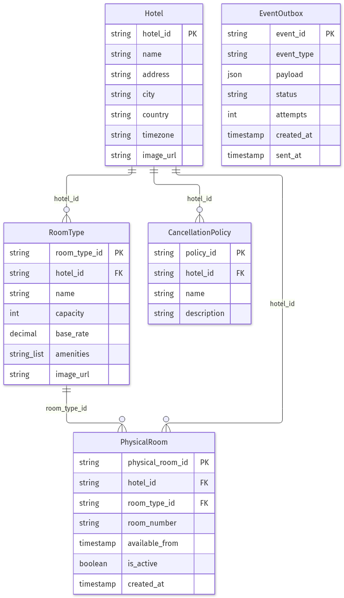{height=8.2in}

`Hotel` es la raíz; `RoomType`, `CancellationPolicy` y `PhysicalRoom` cuelgan de él. `PhysicalRoom` también referencia `RoomType`, y la unicidad `(hotel_id, room_number)` impide duplicar números dentro de un hotel. `RoomType.amenities` es una lista de strings y `base_rate` es el precio de referencia. `EventOutbox` registra `physical-room.created` cuando se crea una habitación física; rate-availability lo consume para inicializar inventario.

## 5.4 Rate & Availability Service

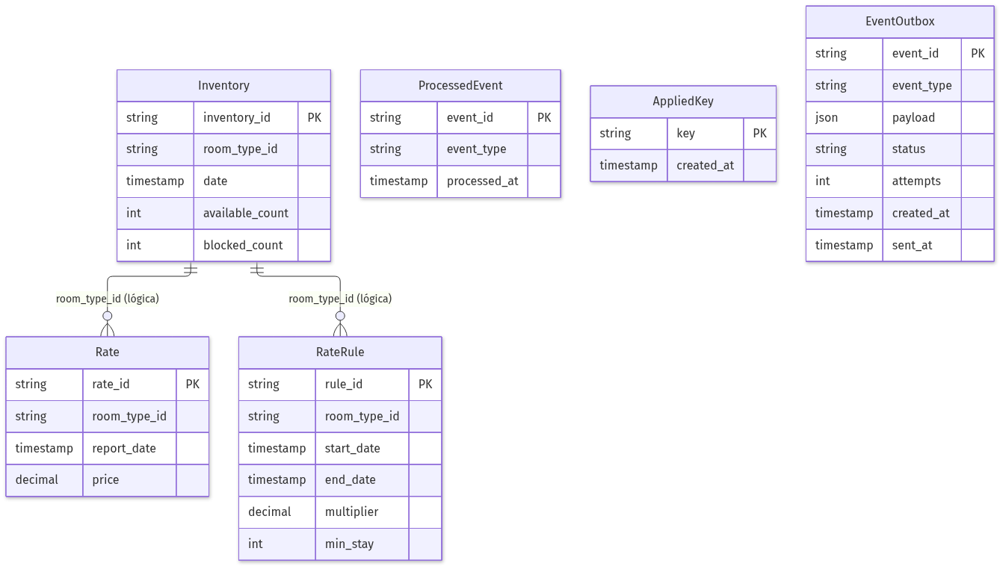{width=6.2in}

`Inventory` tiene unicidad `(room_type_id, date)` y lleva `available_count` y `blocked_count`. `Rate` guarda el precio por tipo y fecha; `RateRule` define multiplicadores por rango con `min_stay`; `ProcessedEvent` y `AppliedKey` son las tablas de idempotencia. Las líneas punteadas del diagrama son relaciones lógicas por `room_type_id`, no claves foráneas: el servicio no tiene una tabla `RoomType`, porque esa entidad pertenece a property. `EventOutbox` publica `availability.updated` y `rate.updated`.

## 5.5 Booking Service

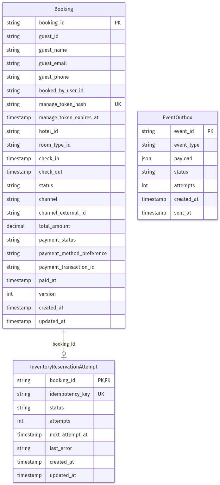{height=8.2in}

`Booking` concentra el ciclo de vida: `status` (`pending`, `confirmed`, `cancelled`, `completed`), `payment_status` (`PENDING`, `PAID`, `REFUNDED`), `payment_method_preference` (`ONLINE`, `RECEPTION`), `version` para concurrencia optimista y `manage_token_hash` para acceso sin sesión. La unicidad `(channel, channel_external_id)` evita duplicar una reserva OTA. `InventoryReservationAttempt` es la saga durable: `booking_id` es PK y FK, `idempotency_key` es única, `next_attempt_at` guía el reconciliador. `EventOutbox` publica los cuatro eventos de booking.

## 5.6 User Service

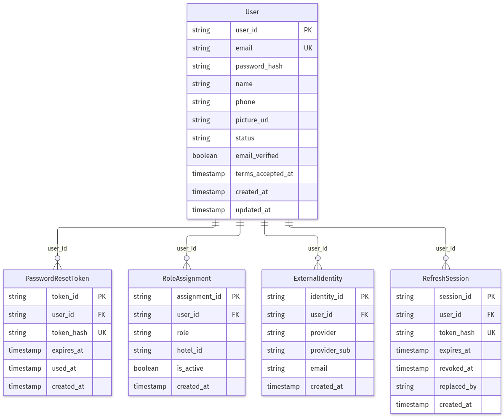{width=6.2in}

`User` es la cuenta; `RoleAssignment` separa el rol del hotel y permite que un usuario tenga asignaciones distintas (aunque la UI trabaja con una activa). `ExternalIdentity` vincula Auth0/Google por `(provider, provider_sub)` y no por email. `RefreshSession` guarda el hash del refresh token, su expiración y la cadena de reemplazo (`replaced_by`), lo que permite rotación y detección de reuso. `PasswordResetToken` guarda solo el hash del código, con expiración y `used_at`.

## 5.7 Front Desk Service

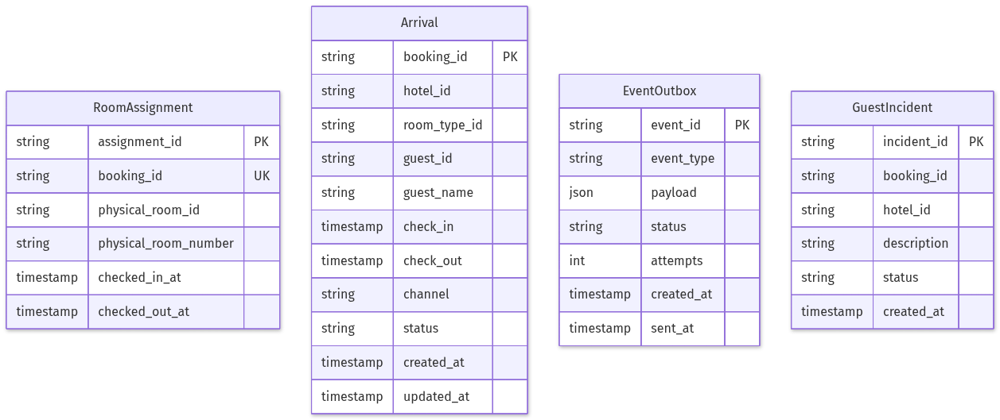{width=6.2in}

`Arrival` es un read model de la reserva confirmada: `booking_id` es PK, y el upsert por evento lo mantiene sincronizado. `RoomAssignment` tiene `booking_id` único, lo que impide dos check-in de la misma reserva; guarda `checked_in_at` y `checked_out_at`. `GuestIncident` registra incidentes por reserva y hotel. `EventOutbox` publica `checkout.completed` y `booking.completed` en la misma transacción del check-out.

## 5.8 Housekeeping Service

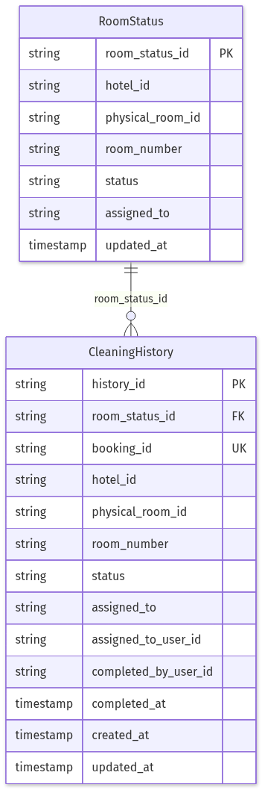{height=8.2in}

`RoomStatus` tiene unicidad `(hotel_id, room_number)` y guarda el estado actual (`dirty`, `cleaning`, `clean`, `maintenance`) y la persona asignada. `CleaningHistory` conserva el historial por `booking_id` único y referencia `RoomStatus`; guarda `assigned_to`, `assigned_to_user_id`, `completed_by_user_id` y `completed_at`. No hay una tabla de habitaciones: el número y el `physical_room_id` vienen de property a través de booking.

## 5.9 Billing Service

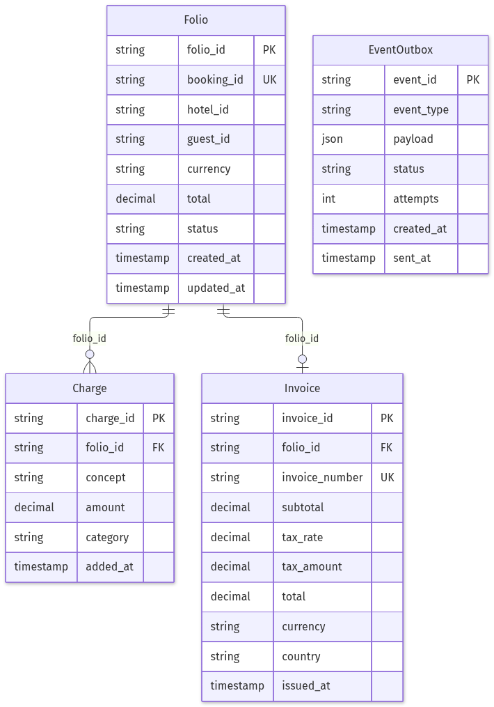{height=8.2in}

`Folio` tiene `booking_id` único y estado `open`/`closed`; `Charge` referencia el folio y clasifica el cargo (`room`, `minibar`, `restaurant`, `other`). `Invoice` es uno a uno con el folio, con `invoice_number` único, subtotal, impuesto, total y país. El cierre es idempotente: si ya existe factura, se retorna la existente. `EventOutbox` publica `folio.closed`; al 30-oct no hay consumidor para ese evento.

## 5.10 Payment Service

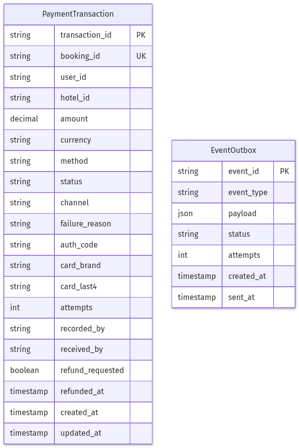{height=8.2in}

`PaymentTransaction` tiene `booking_id` único, monto, moneda, método, estado (`PROCESSING`, `COMPLETED`, `FAILED`, `REFUNDED`), marca y últimos cuatro dígitos de la tarjeta simulada, código de autorización, `refund_requested` y `refunded_at`. No se almacenan números completos ni CVV. `EventOutbox` publica `payment.completed` y `payment.refunded`.

## 5.11 Loyalty Service

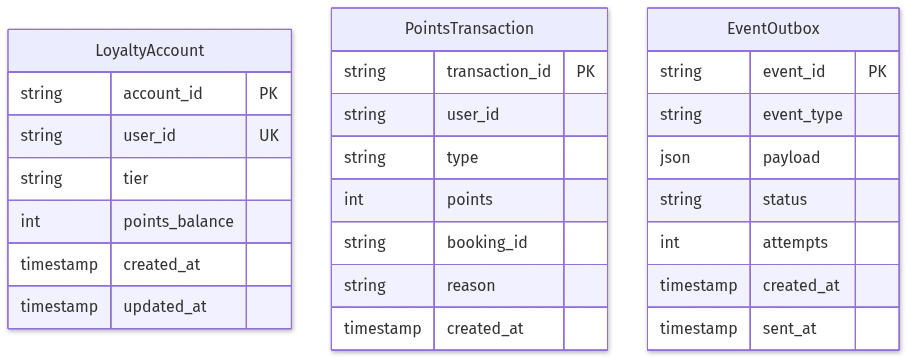{width=6.2in}

`LoyaltyAccount` tiene `user_id` único, `tier` y `points_balance`. `PointsTransaction` registra `earn`, `redeem` y `reverse`, con unicidad `(booking_id, type)` para que un replay no duplique puntos. El índice `(user_id, created_at DESC)` acelera el historial. `EventOutbox` existe en el esquema, pero no se usa para publicar eventos: loyalty es consumidor puro.

## 5.12 Channel Manager Service

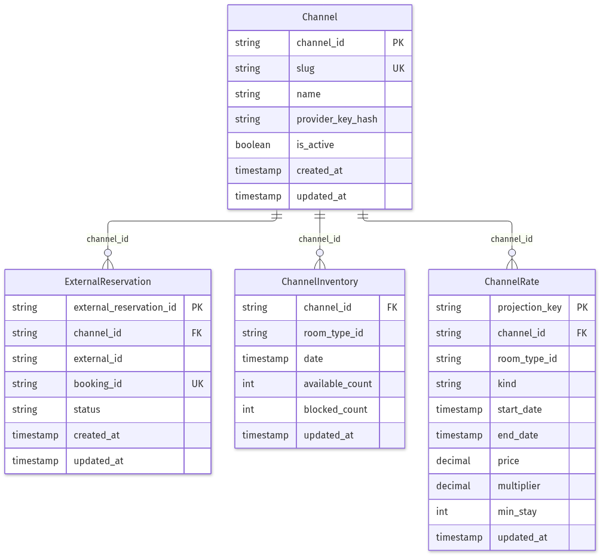{width=6.2in}

`Channel` representa un OTA o canal simulado, con `slug` único y `provider_key_hash`. `ExternalReservation` tiene unicidad `(channel_id, external_id)` y `booking_id` único; guarda el estado espejo de la reserva. `ChannelInventory` tiene PK compuesta `(channel_id, room_type_id, date)`; `ChannelRate` usa una `projection_key` y guarda `kind`, rango, precio, multiplicador y estancia mínima. Las tres tablas hijas referencian `Channel`; no hay FK hacia booking ni rate-availability.

## 5.13 Analytics Service

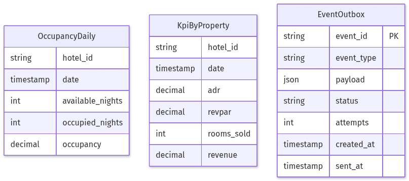{width=6.2in}

`OccupancyDaily` y `KpiByProperty` tienen PK compuesta `(hotel_id, date)`. La primera guarda noches disponibles/ocupadas y ocupación; la segunda guarda ADR, RevPAR, habitaciones vendidas e ingresos. `EventOutbox` publica `metrics.updated`. No hay relaciones: analytics no replica el modelo transaccional, solo agregados. El ETL es idempotente por esa clave compuesta.

## 5.14 Reglas de integridad y consistencia

| Regla | Servicio | Implementación |
|---|---|---|
| Una reserva no se confirma dos veces | booking | `version` + `updateMany` condicional; 409 en conflicto |
| Una reserva no duplica inventario | rate-availability | `reserve` idempotente por clave; transacción con lock |
| Un check-in por reserva | front-desk | `RoomAssignment.booking_id` único |
| Un folio por reserva | billing | `Folio.booking_id` único |
| Una factura por folio | billing | `Invoice.folio_id` único |
| Un pago por reserva | payment | `PaymentTransaction.booking_id` único |
| Puntos una vez por reserva | loyalty | `@@unique([booking_id, type])` |
| Tarea una vez por check-out | housekeeping | `CleaningHistory.booking_id` único |
| Llegada una vez por reserva | front-desk | `Arrival.booking_id` PK y upsert |
| Evento publicado una vez | varios | Outbox `pending` → `sent`, publisher confirm |

# 6. Comunicación y eventos

## 6.1 Comunicación síncrona

Las llamadas síncronas usan HTTP/JSON con timeout. Los clientes internos se implementan en `src/lib/*-client.ts` y se autentican con `x-service-key` (`SERVICE_API_KEY` o claves específicas como `BOOKING_SERVICE_KEY`, `PAYMENT_SERVICE_KEY`, `LOYALTY_SERVICE_KEY`, `CHANNEL_MANAGER_SERVICE_KEY`). Las llamadas de usuario llevan `Authorization: Bearer <JWT>`.

| Llamada | Origen → destino | Autenticación | Propósito |
|---|---|---|---|
| Reservar/liberar inventario | booking → rate-availability | `x-service-key` | Confirmar o cancelar una reserva |
| Crear checkout | frontend → payment | JWT | Iniciar el pago |
| Consultar reserva | payment/housekeeping/front-desk → booking | `x-service-key` | Validar monto, hotel y estado |
| Consultar usuario | loyalty → user | `x-service-key` | Verificar que la cuenta esté activa |
| Consultar disponibilidad/tarifa | channel-manager → rate-availability | `x-service-key` | Sincronizar snapshots del canal |
| Crear reserva OTA | channel-manager → booking | `x-service-key` + `x-provider-key` | Ingesta de una reserva externa |
| Consultar puntos | user → loyalty | `x-service-key` | Mostrar puntos en el perfil |

Los timeouts y reintentos son locales a cada cliente. No hay un presupuesto de timeout común ni un circuit breaker; si un destino está lento, la llamada falla y el servicio decide si devuelve 502/503 o si deja el trabajo para un reconciliador. Booking es el caso más elaborado: si `reserve` falla, la reserva pagada queda con una saga pendiente y el reconciliador reintenta cada 15 segundos.

## 6.2 Eventos y colas

La Figura 13 muestra el catálogo implementado. El exchange es `hotelsync.events`, de tipo topic, y las colas son durables. Cada consumidor declara su cola y sus bindings; no hay un exchange de dead-letter ni una cola de mensajes fallidos: los errores transitorios se reencolan y los permanentes se descartan con `ack`.

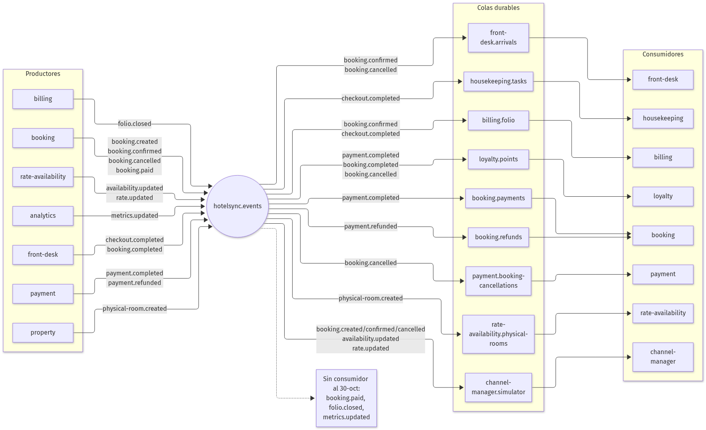{width=6.2in}

El catálogo tiene 13 tipos de evento y nueve colas:

| Evento | Productor | Consumidores | Cola(s) | Efecto |
|---|---|---|---|---|
| `booking.created` | booking | channel-manager | channel-manager.simulator | No-op: la reserva pendiente no compromete inventario; la externa ya se registró en la ingesta |
| `booking.confirmed` | booking | front-desk, billing, channel-manager | front-desk.arrivals, billing.folio, channel-manager.simulator | Crea llegada, abre folio, sincroniza canal |
| `booking.cancelled` | booking | front-desk, loyalty, payment, channel-manager | front-desk.arrivals, loyalty.points, payment.booking-cancellations, channel-manager.simulator | Cancela llegada, revierte puntos, reembolsa, sincroniza canal |
| `booking.paid` | booking | — | — | Registro del pago; sin consumidor al 30-oct |
| `checkout.completed` | front-desk | housekeeping, billing | housekeeping.tasks, billing.folio | Marca habitación sucia, crea tarea, cierra folio |
| `booking.completed` | front-desk | loyalty | loyalty.points | Respaldo idempotente para acreditar puntos |
| `folio.closed` | billing | — | — | Cierre contable; sin consumidor al 30-oct |
| `payment.completed` | payment | booking, loyalty | booking.payments, loyalty.points | Marca pago, confirma reserva, acredita puntos |
| `payment.refunded` | payment | booking | booking.refunds | Refleja el reembolso en la reserva |
| `metrics.updated` | analytics | — | — | Agregado hotel-día; sin consumidor al 30-oct |
| `physical-room.created` | property | rate-availability | rate-availability.physical-rooms | Inicializa inventario de la habitación |
| `availability.updated` | rate-availability | channel-manager | channel-manager.simulator | Actualiza snapshot de disponibilidad |
| `rate.updated` | rate-availability | channel-manager | channel-manager.simulator | Actualiza snapshot de tarifa |

## 6.3 Outbox y entrega

El patrón es siempre el mismo. En una transacción Prisma se escribe el cambio de estado y una fila en `EventOutbox` con `event_id`, `event_type`, `payload`, `status="pending"`, `attempts=0`. Un dispatcher (`startOutboxDispatcher`) corre cada 5 o 10 segundos según el servicio, lee los `pending`, publica con publisher confirm y marca `sent`. Si RabbitMQ no está configurado o falla, las filas quedan `pending` y la operación de negocio ya está confirmada en la base. Esa es la garantía central: **el broker no es parte de la transacción de negocio**.

Los consumidores usan `ack` manual y `prefetch` bajo (1 en booking y loyalty). Un payload inválido se descarta con `ack` y se loguea; un error transitorio se `nack` con requeue y una pausa. No hay límite de reintentos por mensaje: un mensaje veneno puede reencolarse indefinidamente, aunque los validadores Zod y los `ack` de payload inválido reducen ese riesgo. La ausencia de DLQ es una limitación conocida [P].

La idempotencia del consumidor es la segunda línea de defensa. Ejemplos: `Arrival` y `Folio` usan `booking_id` único; loyalty usa `(booking_id, type)`; rate-availability usa `ProcessedEvent`/`AppliedKey`; booking usa `InventoryReservationAttempt` y el estado `payment_status` para ignorar pagos repetidos.

## 6.4 Secuencia de una reserva

La Figura 14 muestra el camino feliz desde la creación hasta el check-out, incluyendo la confirmación por pago y la reacción en cadena. El punto crítico es la confirmación de la reserva y la reserva de inventario en booking: ambas forman una misma operación lógica; si el segundo paso falla, la saga queda pendiente y el reconciliador la retoma.

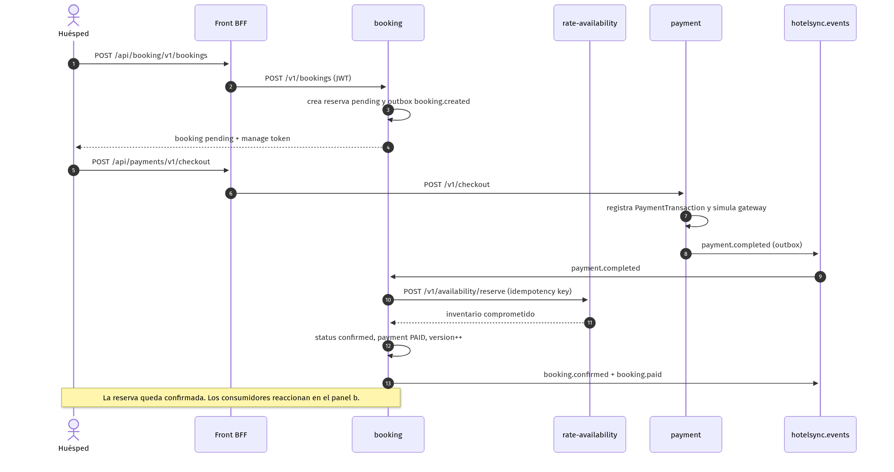{width=6.2in}

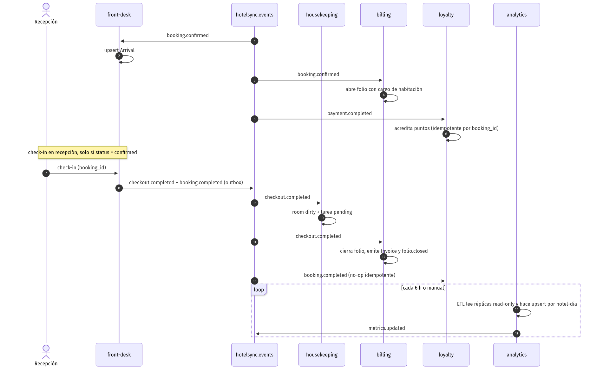{width=6.2in}

La cancelación sigue un camino distinto: booking libera inventario si la reserva estaba confirmada, emite `booking.cancelled`; payment consume el evento y reembolsa; loyalty revierte puntos; front-desk cancela la llegada; channel-manager sincroniza el canal. Si la reserva aún no estaba pagada, no hay reembolso y loyalty no tiene puntos que revertir (su operación es no-op).

## 6.5 Versionado de eventos

No hay un registro de esquemas ni un formato versionado explícito. Cada evento lleva un payload JSON con campos estables y los consumidores lo validan con Zod. Un cambio incompatible requiere coordinar productor y consumidores en el mismo despliegue, algo viable con once servicios pequeños pero riesgoso en producción. La mejora pendiente es un campo `schema_version` y validadores tolerantes [P].

El costo de un cambio incompatible no es solo técnico: obliga a coordinar productor y consumidores, y la ventana se amplifica porque las colas son durables y un mensaje viejo puede llegar después del despliegue. La recomendación es tratar el payload como contrato: versión explícita, catálogo de eventos y pruebas de compatibilidad en CI. Mientras eso no exista, la regla operativa es no renombrar ni eliminar campos; solo agregar campos opcionales y coordinar la ventana de despliegue.

| Práctica | Estado al 30-oct | Acción recomendada |
|---|---|---|
| Versión en el envelope | No existe `schema_version` [P] | Añadirla antes del próximo cambio incompatible |
| Catálogo de eventos | Documentado en §6.2, sin registro ejecutable | Publicar JSON Schema o validadores compartidos |
| Validación del consumidor | Zod en el borde | Mantener los campos nuevos como opcionales |
| Pruebas de contrato | No se documenta una suite dedicada | Probar cada payload contra todos los consumidores en CI |
| Cambio incompatible | Coordinación manual en un solo despliegue | Ventana de doble publicación o compatibilidad temporal |

# 7. Frontend y BFF

## 7.1 Stack y estructura

El frontend es una sola aplicación Next.js 15 con App Router, React 19, TypeScript y Tailwind. `apps/admin` es un frontend heredado y no es el que se despliega. La aplicación tiene dos superficies:

- **Portal público:** inicio, búsqueda, detalle de hotel, disponibilidad, reserva, mis reservas, cuenta (crear, entrar, perfil, recuperar, restablecer), privacidad y términos.
- **Panel `/admin`:** dashboard, analytics, hoteles (lista, alta, detalle, inventario, habitaciones), housekeeping, recepción, simulador de canal y personal.

Las páginas usan Client Components para interacción y llaman a `/api/*` del mismo origen. El servidor de Next hace de BFF: reescribe diez prefijos hacia los servicios (directo o vía `GATEWAY_URL` según `GATEWAY_SERVICES`) y conserva las cookies HttpOnly. La ruta `/api/simulator/reservations` no es un rewrite: es un Route Handler que exige `SUPER_ADMIN` e inyecta `x-provider-key` del lado servidor; cuando `channel-manager` está en `GATEWAY_SERVICES` llama a `GATEWAY_URL/channel-manager/*` y agrega `x-gateway-secret`. `/api/rates` y `/api/warmup` son handlers auxiliares.

## 7.2 Rewrites del BFF

| Prefijo público | Destino por defecto | Servicio |
|---|---|---|
| `/api/property/*` | `http://localhost:3001/v1/*` | property |
| `/api/rate/*` | `http://localhost:3002/v1/*` | rate-availability |
| `/api/users/*` | `http://localhost:3003/v1/*` | user |
| `/api/booking/*` | `http://localhost:3004/v1/*` | booking |
| `/api/front-desk/*` | `http://localhost:3005/v1/*` | front-desk |
| `/api/housekeeping/*` | `http://localhost:3006/v1/*` | housekeeping |
| `/api/billing/*` | `http://localhost:3007/v1/*` | billing |
| `/api/loyalty/*` | `http://localhost:3009/v1/*` | loyalty |
| `/api/payments/*` | `http://localhost:3010/v1/*` | payment |
| `/api/analytics/*` | `http://localhost:3011/v1/*` | analytics |

channel-manager no tiene rewrite: solo se accede por el Route Handler del simulador. En producción, cada `NEXT_PUBLIC_*_API_URL` apunta al servicio correspondiente en Render; en local, los valores por defecto apuntan a `localhost`.

## 7.3 Sesión, cookies y roles

El flujo de login local es: el formulario llama a `/api/auth/login`; el Route Handler llama a user-service, recibe `access_token` y `refresh_token`, y setea dos cookies HttpOnly (`hs_access` y `hs_refresh`) con `SameSite=Lax`, `Secure` en producción y expiración. El middleware lee `hs_access`, decodifica el payload (sin verificar firma; la verificación real la hace cada servicio) y lo inyecta como `Authorization: Bearer` en las llamadas a `/api/*`.

La renovación no ocurre en el middleware: las cookies seteadas sobre `NextResponse.next()` se pierden cuando la respuesta pasa por un rewrite externo. Por eso `/api/auth/refresh` rota el refresh token y setea las cookies en una respuesta propia; `/api/auth/me` intenta renovar si el access expiró; y el cliente reintenta una vez con single-flight. El logout revoca el refresh token en user-service y borra ambas cookies.

La protección de rutas es de dos niveles. En rutas `/admin`, el middleware redirige a `/cuenta/entrar` si no hay rol o si el rol es `GUEST`; redirige a la ruta por defecto si el rol no puede ver el path. `SUPER_ADMIN` ve todo; `MANAGER` ve dashboard, hoteles, personal y analytics de su hotel; `RECEPTIONIST` solo recepción; `HOUSEKEEPER` solo housekeeping. El backend vuelve a verificar el rol y el alcance en cada endpoint: el middleware es UX, no la frontera de seguridad.

## 7.4 Login federado

El botón de Google llama a `/api/auth/google`, que genera `state`, `nonce` y `code_verifier`, los guarda en cookies de corta vida y redirige a Auth0. El callback valida `state`, intercambia el código, verifica el `id_token` contra el nonce y llama a `POST /v1/auth/federated` de user-service. user-service busca o crea el usuario, vincula `ExternalIdentity` por `(provider, provider_sub)` y emite sus propios tokens. El frontend nunca usa el token de Auth0 como token de sesión.

Si el callback falla, redirige a `/cuenta/entrar?error=oauth&step=...` para diagnosticar. La configuración de Auth0 debe alinear `AUTH0_CLIENT_ID` entre el frontend y user-service; un desajuste produce un error de audiencia. Las URLs de preview de Vercel cambian por deploy, por lo que no se whitelistean: solo se configuran las URLs estables.

## 7.5 Deuda de UI

La auditoría `AUDITORIA-UI-2026-10-26.md` identificó diez hallazgos (H1–H10) de accesibilidad, consistencia visual y responsive. Al 30-oct, los cambios de UI están en el árbol de trabajo pero no commiteados; el split de front tiene su último commit el 18-oct. Esto significa que producción puede no reflejar la última revisión visual. La deuda se registra en la sección 14.

# 8. DevOps y entornos

## 8.1 Desarrollo local

El monorepo usa npm workspaces con Node.js 20 o superior. El flujo estándar es:

1. `npm run db:up` levanta 26 contenedores: 11 bases PostgreSQL, RabbitMQ, Redis, Adminer, el api-gateway y los 11 servicios (opcional; los servicios también se corren con `npm run dev:*`).
2. Copiar `.env.example` a `.env` en cada servicio y en el frontend.
3. `npm install` en la raíz.
4. `npm run migrate:<servicio>` y `npm run seed:<servicio>` para preparar cada base.
5. `npm run dev:<servicio>` o `npm run dev:front`.

Los puertos locales son 3001–3011 para los servicios, 3000 para el front, 5432–5442 para las bases, 5672/15672 para RabbitMQ, 6379 para Redis, 8080 para el api-gateway y 8082 para Adminer. La asignación exacta de bases es: property 5432, rate 5433, booking 5434, front-desk 5435, housekeeping 5436, billing 5437, user 5438, channel-manager 5439, loyalty 5440, payment 5441, analytics 5442.

## 8.2 Configuración

Cada servicio valida al arranque las variables que no puede inferir. Las principales son:

- `DATABASE_URL` obligatoria en todos.
- `AUTH_JWT_SECRET` en los servicios que verifican JWT (property, rate, user, booking, front-desk, housekeeping, billing, payment, loyalty, analytics).
- `RABBITMQ_URL` en los servicios que publican o consumen; sin ella, el outbox queda `pending` y la API sigue.
- `REDIS_URL` opcional en rate-availability.
- URLs de otros servicios (`BOOKING_SERVICE_URL`, `RATE_SERVICE_URL`, `USER_SERVICE_URL`, `PROPERTY_SERVICE_URL`, `CHANNEL_MANAGER_API_URL`).
- En el gateway: `GATEWAY_SHARED_SECRET`, las once `*_SERVICE_URL` (`CHANNEL_MANAGER_SERVICE_URL` termina en `/v1/simulator`), `UPSTREAM_TIMEOUT_MS` (45000 en producción por los cold starts de Render) y `PORT`. En el BFF: `GATEWAY_URL`, `GATEWAY_SHARED_SECRET` y `GATEWAY_SERVICES` (vacía = rollback total).
- Claves de servicio (`SERVICE_API_KEY`, `BOOKING_SERVICE_KEY`, `PAYMENT_SERVICE_KEY`, `LOYALTY_SERVICE_KEY`, `CHANNEL_MANAGER_SERVICE_KEY`, `CHANNEL_MANAGER_SIMULATOR_KEY`).
- `DATABASE_URL_BOOKING` y `DATABASE_URL_PROPERTY` en analytics.

En producción, las variables se configuran en Render, Vercel y Neon. No hay un secret manager dedicado ni rotación automática; el secreto JWT es compartido y debe rotarse de forma coordinada. Esa es una deuda de seguridad documentada.

## 8.3 Estrategia de repositorios

El desarrollo ocurre en un monorepo privado. La entrega se hace en once repositorios split públicos (`iI3lue/hotelsync-*`), uno por servicio, más el split del frontend. Cada split tiene su propio `package.json`, su Dockerfile (para desarrollo o builds alternativos), su workflow y su configuración de Render/Neon.

La sincronización monorepo → split es manual y selectiva: se copian `src`, `tests` y `prisma`, no el `Dockerfile`, `package.json` o `.env` sin revisar. Antes de pushear se comparan hashes de ambas vías. Esta estrategia permitió demostrar despliegues independientes, pero introdujo drift: hay endpoints que existen en un split y no en el monorepo (o al revés), y fixes que están en un lado y no en el otro. El caso más grave es analytics: el monorepo tiene el aislamiento por hotel, el split desplegado no.

## 8.4 Docker

`docker-compose.yml` define 26 servicios y volúmenes para persistencia. Se usa para desarrollo local y para pruebas manuales; no es el mecanismo de despliegue. Render ejecuta Node.js nativo con `npm ci && npx prisma generate && npm run build`, y arranca con `npx prisma migrate deploy && npm start` (el api-gateway usa `npm start` sin Prisma). Vercel construye el front con `next build`. No hay imágenes publicadas en un registry ni un pipeline de contenedores.

## 8.5 Ambientes

| Ambiente | Frontend | Backends | Bases | Broker | Datos |
|---|---|---|---|---|---|
| Local | `next dev` :3000 | `tsx watch` :3001–3011 | PostgreSQL en Docker | RabbitMQ en Docker | Seeds de demo |
| Producción | Vercel | Render (11) | Neon (11) | CloudAMQP | Datos reales de demo |
| Staging | No existe | No existe | No existe | No existe | — |

La ausencia de staging significa que un cambio en `main` puede llegar a producción sin una validación integrada contra datos reales. El CI valida tipos, builds y tests, pero los tests mockean Prisma y HTTP; no hay un E2E contra la base. Esa combinación es el principal riesgo de despliegue.

# 9. Integración y despliegue continuo

## 9.1 CI del monorepo

El workflow `.github/workflows/ci.yml` se dispara en `push` y `pull_request` sobre `main`. Tiene un solo job, `lint-test-build`, que ejecuta:

1. `actions/checkout@v4` y `actions/setup-node@v4` con Node.js 20 y caché de npm.
2. Seis contenedores PostgreSQL 16 efímeros en los puertos 5432–5437 (property, rate, booking, front-desk, housekeeping, billing).
3. `npm ci`.
4. `prisma migrate deploy` en esos seis servicios.
5. `npm run build` en los seis servicios y en `apps/front`.
6. `npm test --workspaces --if-present`.

El alcance real es desigual: el job migra y construye seis backends, pero ejecuta los tests de todos los workspaces que tengan script. User, channel-manager, loyalty, payment y analytics no se construyen ni migran en este workflow; sus tests corren porque no necesitan una base real. El frontend se construye con `next build`, pero no se ejecuta `next lint`. No hay un paso explícito de `tsc --noEmit`: el `build` de cada servicio ya es `tsc`, así que el typecheck queda cubierto por la compilación.

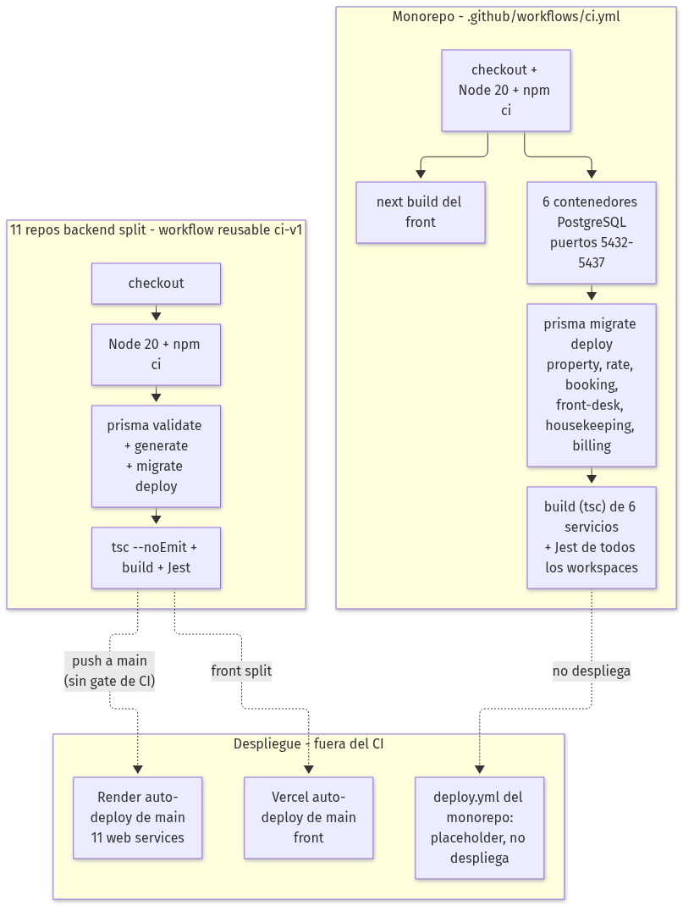{width=6.2in}

## 9.2 CI de los repositorios split

Los once repositorios backend usan un workflow reutilizable (`on.workflow_call`) que vive en `iI3lue/hotelsync-loyalty-service/.github/workflows/node-service-ci.yml`. Cada repositorio tiene un caller delgado fijado al tag `ci-v1`. El workflow recibe `service_name`, `db_name`, `fail_on_purpose` y el secreto `CI_POSTGRES_PASSWORD`; ejecuta checkout sin persistir credenciales, Node 20 con caché, `npm ci`, `prisma validate`, `prisma generate`, `prisma migrate deploy` contra un PostgreSQL 16 efímero, `tsc --noEmit`, build, Jest con cobertura y publicación del artefacto. Aplica `contents: read`, `concurrency` para cancelar ejecuciones obsoletas, timeout de 15 minutos y un fallo controlado disponible solo por `workflow_dispatch`.

Al 27-oct-2026, las once ejecuciones de `main` terminaron en verde con **399 pruebas en 48 suites**. La distribución va de 5 pruebas en channel-manager a 87 en booking. El detalle por repositorio y los enlaces a cada ejecución están en el Anexo E.

El diseño tiene una virtud y un riesgo. La virtud es que la política de calidad se define una vez y se versiona con un tag inmutable. El riesgo es que un error en loyalty rompe once pipelines a la vez, y que el workflow vive en un repositorio de negocio en lugar de uno dedicado a infraestructura. El caller local de loyalty prueba que la definición sigue funcionando, pero no elimina el acoplamiento.

## 9.3 Despliegue

El despliegue no lo ejecuta GitHub Actions. Render y Vercel observan la rama `main` de cada repositorio split y despliegan automáticamente cuando hay un push. El workflow `deploy.yml` del monorepo es un placeholder: imprime instrucciones, no despliega, y su `needs: [ci]` referencia un job que no existe en ese archivo, por lo que no es una compuerta válida. No hay promoción por ambientes, aprobación manual ni espera del resultado del CI antes del auto-deploy.

| Componente | Mecanismo | Disparador | Rollback |
|---|---|---|---|
| 11 backends | Render Web Service (Node.js) | Push a `main` del split | Redeploy manual de un commit anterior |
| Frontend | Vercel (Next.js) | Push a `main` de `hotelsync-front` | Rollback instantáneo a un deployment previo |
| Bases | Neon | Migraciones `prisma migrate deploy` en el arranque | Restauración manual / PITR de Neon |
| Broker | CloudAMQP | Configuración manual | Recrear instancia o cambiar `RABBITMQ_URL` |
| Auth | Auth0 | Configuración manual | Revertir configuración en el dashboard |

El arranque de Render ejecuta `npx prisma migrate deploy && npm start`; el build es `npm ci && npx prisma generate && npm run build`. Eso significa que una migración se aplica en cada arranque, incluso en un cold start, y que un fallo de migración impide que el servicio levante. No hay migraciones separadas del proceso de arranque ni un job de migración independiente.

## 9.4 Topología de producción

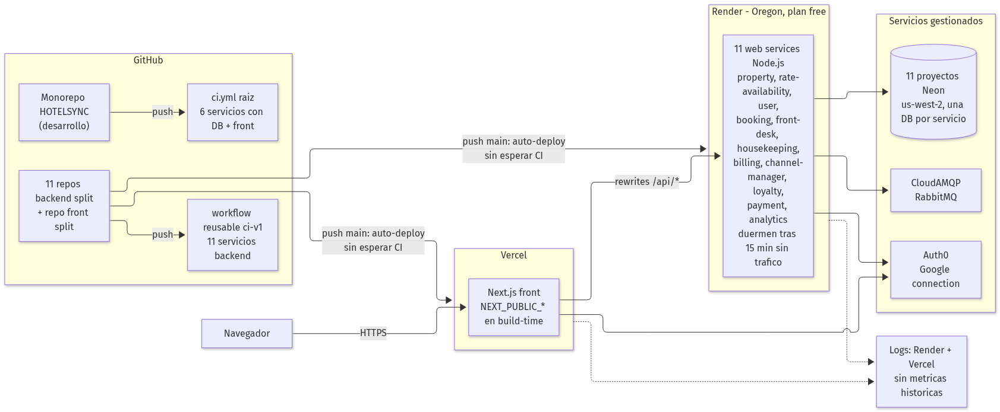{width=6.2in}

La topología es deliberadamente simple: un navegador habla con Vercel por HTTPS; Vercel reescribe `/api/*` hacia el api-gateway de Render (o directo al servicio si ese prefijo no está en `GATEWAY_SERVICES`), y el gateway reenvía al servicio con un secreto compartido; cada servicio habla con su base Neon, con CloudAMQP si tiene mensajería y con Auth0 solo en el caso de user-service. No hay VPC, red privada ni malla de servicios. Las llamadas entre servicios viajan por internet público y se protegen con JWT o claves de servicio.

Las consecuencias operativas son concretas:

- **Cold start:** Render free suspende un servicio tras 15 minutos sin tráfico; el primer request puede tardar 30–90 segundos. El frontend mitiga con `/api/warmup`, que despierta los once servicios en paralelo con un timeout de 12 segundos y responde 200 aunque alguno siga arrancando.
- **Cuotas:** Neon y CloudAMQP tienen límites de plan gratuito. La cuota de mensajes de CloudAMQP se agotó el 28-oct y dejó el broker inoperante; los outbox siguen escribiendo, pero no publican.
- **Build-time:** las variables `NEXT_PUBLIC_*` se incrustan en el build de Vercel. Cambiar una URL exige redeploy, no alcanza con editar la variable.
- **Sin staging:** no hay un ambiente intermedio. Un push a `main` de un split puede llegar a producción sin una prueba integrada.

## 9.5 Estado de verificación en producción

La verificación del 30-oct-2026 sobre 12 endpoints (11 servicios + front) dio **10 respuestas 200**. Las dos excepciones son los `/health` de housekeeping y billing, que se quedan colgados porque intentan conectar al broker y el cliente de RabbitMQ reintenta sin límite cuando la cuota de CloudAMQP está agotada. Las APIs reales de esos servicios responden 401 en menos de 0,6 segundos, es decir, el proceso está vivo y solo el health check queda atrapado en la conexión.

| Servicio | Health 30-oct | Observación |
|---|---|---|
| property | 200 | — |
| rate-availability | 200 | — |
| user | 200 | — |
| booking | 200 | Health estático, no toca el broker |
| front-desk | 200 | — |
| housekeeping | Sin respuesta | Health bloqueado por `broker.connect()` |
| billing | Sin respuesta | Health bloqueado por `broker.connect()` |
| channel-manager | 200 | — |
| loyalty | 200 | — |
| payment | 200 | — |
| analytics | 200 | — |
| frontend | 200 | — |

# 10. Observabilidad y operación

## 10.1 Health checks

Todos los servicios exponen `GET /health`. La mayoría devuelve un JSON estático con `status`, `service` y `timestamp`; no consulta la base ni el broker. Booking es explícitamente estático. Housekeeping y billing son la excepción: su health intenta inicializar la conexión con RabbitMQ y, si el broker no responde, queda pendiente. Esa diferencia explica por qué el incidente de CloudAMQP se ve como "servicio caído" en dos servicios que en realidad siguen atendiendo requests.

No hay endpoints separados de liveness y readiness, no hay verificación de dependencias (base, broker, auth) y no hay un health agregado. El frontend usa `/api/warmup` como mecanismo de despertar, no como semáforo de disponibilidad.

## 10.2 Logs y trazabilidad

Los servicios escriben logs con `console.log` y `console.error`, con un prefijo de servicio (`[booking-service]`, `[payment-service]`, etc.). Render y Vercel los capturan y permiten filtrarlos por servicio. No hay logging estructurado en JSON, niveles formales, correlation IDs, request IDs, trazas distribuidas ni exportación a un colector central.

El resultado es que reconstruir un flujo que cruza cinco servicios exige correlacionar a mano por `booking_id`, timestamp y los mensajes de cada outbox. Los eventos no llevan un `trace_id` ni un `correlation_id` estándar. Para el alcance académico es suficiente; para operar con SLA no lo es.

## 10.3 Métricas y alertas

No hay Prometheus, Grafana, OpenTelemetry ni un servicio de métricas de infraestructura. El servicio de analytics produce métricas de negocio (ocupación, ADR, RevPAR, ingresos) y publica `metrics.updated`, pero no mide latencia, errores, saturación ni profundidad de colas. El dashboard `/admin/analytics` es una vista de negocio, no un panel de operación.

Las únicas señales operativas son los logs y la inspección manual de las tablas `EventOutbox`, donde se puede ver cuántos eventos quedaron `pending`. No hay alerta cuando ese número crece, cuando un consumidor se detiene o cuando un reconciliador acumula intentos. La deuda de observabilidad es la limitación más importante para llevar el sistema a un entorno con usuarios reales.

## 10.4 Incidente del broker (28-oct-2026)

CloudAMQP agotó la cuota de mensajes del plan gratuito. El exchange `hotelsync.events` dejó de aceptar publicaciones y los consumidores perdieron la conexión. Efectos verificados:

- Los outbox de booking, front-desk, housekeeping, billing, channel-manager, loyalty, payment y analytics acumulan filas `pending`.
- Los `/health` de housekeeping y billing cuelgan por el retry infinito de conexión.
- Las APIs síncronas siguen respondiendo; un request autenticado devuelve 401 en menos de 0,6 segundos, lo que confirma que el proceso y la base están sanos.
- Property, rate-availability y user no usan broker y no se ven afectados.

La recomendación operativa es esperar el reinicio de la cuota el 1-nov y no migrar de proveedor en caliente. Si se migrara, hay que actualizar `RABBITMQ_URL` en los ocho servicios que usan mensajería (booking, front-desk, housekeeping, billing, channel-manager, loyalty, payment y analytics) y redesplegar. Los eventos acumulados se publicarían al reconectar, salvo que se hayan descartado; el orden no está garantizado, pero la idempotencia de los consumidores lo tolera.

## 10.5 Capacidad y costos

El sistema corre íntegramente en planes gratuitos: Render free para once backends, Vercel Hobby para el front, Neon free para once bases y CloudAMQP free para el broker. Eso impone límites de CPU, memoria, conexiones, horas de suspensión y mensajes. La arquitectura es correcta para demostración y defensa académica, pero el plan gratuito es parte del diseño operativo: explica los cold starts, la cuota agotada y la ausencia de réplicas.

# 11. Seguridad

## 11.1 Autenticación

user-service es el emisor de tokens. Firma JWT HS256 con `AUTH_JWT_SECRET` (mínimo 32 caracteres) y un payload con `sub`, `email`, `email_verified`, `role`, `hotel_id`, `scope` (`global` o `hotel`), `iss="hotelsync"`, `aud="hotelsync-api"`, `iat` y `exp`. El access token dura **15 minutos**; el refresh token es opaco, dura **7 días**, se guarda como hash SHA-256 en `RefreshSession` y se rota en cada refresh. La cadena `replaced_by` permite detectar reuso y revocar la familia.

Las contraseñas se hashean con **scrypt** de la librería estándar de Node, en formato `scrypt$<salt>$<derived>`; no se usa bcrypt ni un servicio externo. El reset de contraseña usa un código de un solo uso, guardado como hash, con expiración y `used_at`. El login federado con Auth0/Google valida `state`, `nonce` y PKCE, y luego emite los tokens propios de HotelSync: el token de Auth0 no se usa como sesión de la aplicación.

Cada servicio verifica la firma localmente con una copia del verificador HS256. Esa duplicación es intencional por database-per-service, pero implica que una rotación del secreto debe coordinar a todos los verificadores al mismo tiempo. Si un servicio queda con el secreto viejo, devuelve 401 en todas las rutas protegidas.

## 11.2 Autorización

Los roles son `GUEST`, `RECEPTIONIST`, `HOUSEKEEPER`, `MANAGER` y `SUPER_ADMIN`. Las reglas implementadas son:

- `GUEST` reserva, paga, consulta sus reservas y gestiona su cuenta.
- `RECEPTIONIST` opera llegadas, check-in, check-out, folios, cargos, facturas, incidentes y pagos presenciales.
- `HOUSEKEEPER` ve tareas, toma tareas, las inicia y las completa; no asigna tareas ni cambia el estado de una habitación por la ruta directa (solo a través del ciclo de su tarea).
- `MANAGER` administra su hotel, su personal, inventario, tarifas, analytics y housekeeping.
- `SUPER_ADMIN` tiene alcance global y es el único que puede usar el simulador de canales.

El alcance por hotel se implementa comparando `auth.hotel_id` con el `hotel_id` del recurso o del query. Analytics agrega `requireHotelScope`; housekeeping y front-desk filtran por hotel; booking y billing validan pertenencia antes de devolver datos. El middleware del frontend replica estas reglas para la UX, pero la decisión real está en cada servicio.

Hay dos brechas verificadas que deben registrarse con honestidad:

1. **property-service:** las escrituras de hoteles, tipos de habitación y políticas de cancelación no aplican `requireRole`. `POST/PUT /v1/hotels` y `POST/PUT /v1/room-types` aceptan cualquier JWT válido; `POST /v1/cancellation-policies` no tiene `requireAuth`. Un usuario `GUEST` registrado puede crear o editar catálogo llamando directo a la URL pública del servicio. Solo el alta de habitación física aplica `requireHotelManager`.
2. **analytics-service en producción:** el split desplegado no tiene el filtro por hotel que sí está en el monorepo. Un `MANAGER` podría consultar el dashboard de otro hotel si conoce el `hotel_id`. El fix existe en el árbol de trabajo pero no está desplegado.

## 11.3 Autenticación entre servicios

Las llamadas internas usan `x-service-key` con claves estáticas (`SERVICE_API_KEY`, `BOOKING_SERVICE_KEY`, `PAYMENT_SERVICE_KEY`, `LOYALTY_SERVICE_KEY`, `CHANNEL_MANAGER_SERVICE_KEY`). No hay mTLS, OAuth client credentials ni tokens de vida corta. Las claves se distribuyen por variables de entorno y no se rotan automáticamente. El channel-manager usa además `x-provider-key` para el simulador y guarda solo el hash de la clave en `Channel.provider_key_hash`.

Como las APIs están en Render y son públicamente accesibles, una clave filtrada permite llamar a los endpoints internos sin pasar por el frontend. La defensa actual es la rotación manual y el secreto de entorno; no hay una capa de red que aísle el tráfico interno.

## 11.4 Seguridad web

| Control | Estado | Detalle |
|---|---|---|
| HTTPS | Implementado | Render y Vercel terminan TLS |
| Cookies HttpOnly | Implementado | `hs_access` y `hs_refresh`, `SameSite=Lax`, `Secure` en producción |
| CSRF token | No implementado | Mitigación parcial por `SameSite=Lax` y JSON same-origin |
| CSP | No implementado | Sin `Content-Security-Policy` |
| Helmet | No implementado | Solo payment hace `app.disable("x-powered-by")` |
| CORS | No configurado | No hay `cors()` en los servicios; el frontend usa el BFF same-origin |
| Rate limiting | Parcial | Límite en memoria en forgot/code/reset; login y registro sin límite |
| MFA | No implementado | Auth0/Google sin segundo factor obligatorio |
| Validación de entrada | Implementado | Zod en body, query y params |
| Errores sanitizados | Implementado | `AppError` devuelve `{error, message, statusCode}`; 500 genérico |
| Secretos en repositorio | No | `.env` ignorado; `.env.example` sin credenciales |
| Datos de tarjeta | Minimizados | Solo marca y últimos cuatro dígitos; cobro simulado |

El límite en memoria de user-service cubre forgot/code/reset, pero no login ni registro, y no se comparte entre instancias. La ausencia de CSP y de headers de seguridad es una deuda de endurecimiento, no una vulnerabilidad explotada.

## 11.5 Superficie de datos y multi-tenencia

El aislamiento por hotel es lógico, no físico: todos los hoteles comparten las mismas tablas y se separan por `hotel_id`. Un error en un `where` es una fuga cross-tenant, como demostró el split de analytics. No hay Row Level Security de PostgreSQL ni un usuario de base por hotel. La defensa es la disciplina de scoping en cada query y los tests.

Las bases de analytics usan un rol read-only (`hotelsync_analytics_ro`) para leer property y booking, lo que reduce el impacto de una inyección o de un error de escritura. Las consultas raw usan placeholders `$1`/`$2` y reciben fechas validadas por Zod; no se interpola texto de usuario. El ETL nunca migra ni escribe en las réplicas.

# 12. Calidad y pruebas

## 12.1 Cobertura funcional

La suite de los once splits reportó **399 pruebas en 48 suites** el 27-oct-2026:

| Servicio | Pruebas | Suites |
|---|---:|---:|
| booking | 87 | 4 |
| user | 73 | 11 |
| rate-availability | 52 | 7 |
| payment | 48 | 4 |
| property | 34 | 5 |
| front-desk | 33 | 3 |
| analytics | 22 | 4 |
| housekeeping | 20 | 2 |
| loyalty | 13 | 2 |
| billing | 12 | 3 |
| channel-manager | 5 | 3 |
| **Total** | **399** | **48** |

Las pruebas son unitarias y de integración a nivel de controller/servicio. Mockean Prisma y los clientes HTTP, y en varios casos firman tokens con el secreto de test. Eso valida contratos, validaciones, reglas de rol y flujos de error, pero **no** prueba contra una base real ni contra el broker. No hay E2E, no hay pruebas de contrato entre servicios, no hay pruebas de carga y no hay umbral de cobertura que rompa el build.

## 12.2 Controles de calidad

- `lint` en diez servicios ejecuta `tsc --noEmit`; loyalty no tiene script `lint`. En el front, `next lint`.
- El build de cada backend es `tsc`; el del front es `next build`.
- El CI raíz no ejecuta un paso de lint separado; el typecheck queda cubierto por el build de los seis servicios que compila.
- No hay ESLint ni Prettier configurados de forma uniforme; el formato depende del editor.
- No hay análisis estático de seguridad (SAST), escaneo de dependencias ni Dependabot en el alcance documentado.
- No hay protección de rama que exija el check del CI; el informe de GitHub Actions la propone como siguiente paso.

## 12.3 Documentación y QA manual

`README.md`, `ARCHITECTURE.md` y `API.md` cubren la instalación y los contratos principales, pero `API.md` no documenta payment ni channel-manager. Los PRDs de payment, channel-manager, analytics y user-service completan el contexto de decisión. La documentación de despliegue (`HotelSync_Enlaces_Despliegue.md`) está actualizada al 18-oct.

El QA de producción es manual: se consultan los `/health`, se recorre el flujo de reserva y se revisan los logs de Render/Vercel. La auditoría de UI del 26-oct dejó diez hallazgos (H1–H10) de accesibilidad, consistencia y responsive; los cambios están en el árbol de trabajo, sin commit ni despliegue. Ese es el principal riesgo de que la experiencia en producción no coincida con la última revisión.

# 13. Decisiones arquitectónicas

Esta sección resume las decisiones que explican la forma actual del sistema. No son las únicas posibles; son las que se tomaron con el contexto, el tiempo y los recursos disponibles. Cada una tiene una consecuencia que se asume explícitamente.

| ID | Decisión | Contexto | Consecuencia principal |
|---|---|---|---|
| ADR-01 | Monorepo para desarrollo, splits para entrega | Un solo equipo, once servicios y necesidad de repositorios públicos por servicio | Coherencia local, pero drift entre monorepo y splits |
| ADR-02 | Una base PostgreSQL por servicio | Autonomía de despliegue y aislamiento de fallos | Sin joins cross-DB; integración por API/eventos |
| ADR-03 | Prisma + migraciones versionadas | Tipado, productividad y esquema declarativo | Cliente generado obligatorio; migraciones en el arranque |
| ADR-04 | Outbox transaccional + RabbitMQ | Evitar dual-write entre base y broker | Consistencia eventual; outbox puede acumularse |
| ADR-05 | Saga durable para confirmar inventario | La confirmación y la reserva de inventario cruzan dos servicios | Reconciliador cada 15 s; estado intermedio visible |
| ADR-06 | JWT HS256 compartido + claves de servicio | Simplicidad para once servicios y un solo emisor | Rotación coordinada; secreto compartido |
| ADR-07 | BFF con rewrites de Next.js | Evitar CORS y ocultar URLs/claves internas | Rotación de cookies fuera del middleware; acoplamiento al front |
| ADR-08 | Analytics con réplicas read-only y ETL idempotente | No acoplar el reporting a las bases transaccionales | Datos con latencia; rol read-only y sin migraciones |
| ADR-09 | Pago simulado en payment-service | Alcance académico sin pasarela real | No hay cobro real; el flujo sí es representativo |
| ADR-10 | Channel manager con snapshots y simulador | No hay contratos reales de OTA | Proyecciones y simulación, no integración OTA real |
| ADR-11 | Frontend único con `/admin` y roles | Menos repos y una sola experiencia | Un deploy afecta portal y panel a la vez |
| ADR-12 | Sin API Gateway público ni malla de servicios | Costo y complejidad para el alcance | Servicios públicos; seguridad en cada servicio. En 2026-11-02 se agregó un proxy interno detrás del BFF, que no cambia el ADR |

## 13.1 Outbox transaccional (ADR-04)

El problema que resuelve es el dual-write: si el servicio escribe en la base y publica en RabbitMQ por separado, una falla entre ambos pasos deja el sistema inconsistente. La solución es escribir el evento en la misma transacción que el cambio de estado y delegar la publicación a un dispatcher. La consecuencia es que el broker puede estar caído sin afectar la operación, pero los eventos se entregan con retraso y el outbox puede crecer sin límite. No hay limpieza automática de filas `sent` ni alerta por antigüedad de `pending`.

## 13.2 Saga de inventario (ADR-05)

Confirmar una reserva pagada requiere dos operaciones: marcar la reserva como `confirmed` y reservar inventario en rate-availability. No hay transacción distribuida. Booking crea un `InventoryReservationAttempt` con `booking_id` como PK, `idempotency_key` única, estado y `next_attempt_at`. Si la llamada a R&A falla, la reserva queda pagada pero no confirmada, y `startConfirmationReconciler` reintenta cada 15 segundos en lotes de 50. La consecuencia es que existe una ventana en la que el huésped pagó y la reserva aún no está confirmada; la UI debe reflejarla y el operador debe poder verla. La alternativa —confirmar sin inventario— sería peor: sobreventa silenciosa.

## 13.3 Splits y drift (ADR-01)

La entrega exige un repositorio por microservicio, público y desplegable. El monorepo privado es el lugar de desarrollo; los splits son el artefacto de entrega. La sincronización manual por archivos permitió avanzar rápido, pero produjo divergencias reales: endpoints que existen en un split y no en el monorepo, fixes que están en un lado y no en el otro, y un front split con el último commit del 18-oct. La lección es que un split no es una copia: es un repositorio con su propio historial y su propio pipeline. La solución pendiente es un script de sincronización con verificación por hash y un check de paridad en CI.

## 13.4 Analytics desacoplado (ADR-08)

Analytics no replica el modelo transaccional ni hace joins cross-DB. Lee booking y property con un rol read-only, calcula agregados por hotel-día y los escribe en su propia base. El ETL es idempotente por `(hotel_id, date)` y corre al arranque (con 30 segundos de retraso) y cada 6 horas, con un lookback configurable (7 días por defecto en el código, 30 en producción). La consecuencia es que el dashboard no es tiempo real y que un cambio de esquema en booking/property puede romper el ETL; la ventaja es que analytics nunca compite por escritura con los servicios transaccionales y puede reconstruirse desde cero.

# 14. Estado, limitaciones y roadmap

## 14.1 Implementado [I]

- Once microservicios con base propia, API REST, validación Zod y manejo uniforme de errores.
- Flujo completo reserva → pago → confirmación → check-in → check-out → folio → factura, con eventos y outbox.
- Autenticación local con scrypt, JWT HS256, refresh rotativo y login federado con Auth0/Google.
- Roles y alcance por hotel en la mayoría de los servicios; panel `/admin` con vistas por rol.
- Housekeeping con tareas, asignación, inicio, completado e historial.
- Billing con folio, cargos, cierre, factura y evento `folio.closed`.
- Loyalty con niveles, puntos idempotentes, canje y reverso.
- Channel manager con canales, reservas externas, snapshots de inventario/tarifa y simulador.
- Analytics con ETL idempotente, dashboard y KPIs.
- 399 pruebas en 48 suites y CI en los once splits.
- Despliegue real en Render, Vercel, Neon, CloudAMQP y Auth0.

## 14.2 Diseñado, no implementado [D]

| Capacidad | Estado | Nota |
|---|---|---|
| API Gateway | Parcial | Proxy interno implementado (2026-11-02) detrás del BFF; faltan rate limiting, métricas y un punto público propio |
| Prometheus/Grafana | No implementado | Solo logs de Render/Vercel |
| Staging | No implementado | No hay ambiente intermedio |
| MFA | No implementado | Auth0/Google sin segundo factor |
| Rate limiting | Parcial | Solo forgot/code/reset, en memoria; login y registro sin límite |
| Circuit breaker | No implementado | Reintentos locales y timeouts, sin patrón completo |
| Dead-letter queue | No implementado | `nack` con requeue; sin DLQ |
| Registro de esquemas de eventos | No implementado | Validación Zod, sin `schema_version` |
| Pasarela de pago real | No implementado | Cobro simulado |
| Integración OTA real | No implementado | Simulador y snapshots |
| Auditoría de acciones | No implementado | Solo logs de aplicación |
| Backups automáticos | Parcial | Neon ofrece PITR; no hay job propio documentado |

## 14.3 Pendientes verificados [P]

| Prioridad | Hallazgo | Impacto | Acción |
|---|---|---|---|
| P0 | Cuota de CloudAMQP agotada | Outbox sin publicar; health de housekeeping/billing colgado | Esperar reset 1-nov o migrar broker y actualizar 8 servicios |
| P0 | Analytics split sin scoping por hotel | Fuga cross-tenant en producción | Desplegar el fix del monorepo y agregar test de aislamiento |
| P0 | property-service sin `requireRole` en escrituras | Un `GUEST` puede crear/editar hoteles y tipos | Aplicar `requireHotelManager`/`requireRole` y test de autorización |
| P0 | `POST /v1/cancellation-policies` sin auth | Cualquiera puede crear políticas | Exigir JWT y rol de manager |
| P1 | Front split desactualizado (18-oct) | Producción no refleja la última UI | Sincronizar y desplegar el front |
| P1 | H1–H10 de auditoría UI sin commit | Deuda de accesibilidad/responsive | Commit, revisión y deploy |
| P1 | Fixes de analytics sin commit | El fix no llega al split | Commit y sincronización |
| P1 | Sin staging ni E2E | Un cambio puede romper producción sin señal | Ambiente de staging y smoke E2E |
| P2 | `deploy.yml` inválido | No es una compuerta real | Eliminarlo o implementar deploy por hooks |
| P2 | CI raíz no cubre 5 servicios | Typecheck/build incompletos en monorepo | Extender matriz a los 11 |
| P2 | Sin umbral de cobertura | La suite puede degradarse | Umbral mínimo y reporte |
| P2 | Sin rotación de secretos | Riesgo si se filtra `AUTH_JWT_SECRET` | Procedimiento y automatización |
| P3 | `API.md` incompleto | Payment/channel no documentados | Completar contratos |
| P3 | loyalty sin script `lint` | Typecheck no uniforme | Agregar `tsc --noEmit` |

## 14.4 Roadmap

**Fase 0 — estabilización (0–2 semanas).** Restablecer el broker o migrar; desplegar el fix de analytics; cerrar las brechas de autorización de property; sincronizar y desplegar el front; commitear los fixes pendientes; agregar tests de aislamiento por hotel.

**Fase 1 — endurecimiento (1–2 meses).** Rate limiting distribuido en el api-gateway (Redis); Helmet, CSP y CORS explícito; DLQ y política de reintentos; staging con datos sintéticos; smoke E2E en CI; protección de rama que exija el check; rotación documentada de secretos.

**Fase 2 — evolución (3–6 meses).** Observabilidad con métricas, trazas y alertas; registro de esquemas de eventos; auditoría de acciones; MFA para staff; pasarela de pago real; integración OTA real; backups y restauración probados.

# 15. Conclusiones

HotelSync demuestra que un dominio hotelero completo puede construirse con once servicios autónomos, bases separadas y comunicación por eventos, sin un gateway ni una plataforma de observabilidad. El flujo principal funciona de extremo a extremo: una reserva se crea, se paga, se confirma con inventario, se recibe, se limpia, se factura y se agrega en analytics. Esa es la contribución central del trabajo y está respaldada por código, despliegues reales y 399 pruebas.

También demuestra que la arquitectura de microservicios no es gratuita. Cada frontera agrega una falla posible: el broker puede agotar su cuota, una saga puede quedar pendiente, un split puede divergir, un `where` puede olvidar el `hotel_id`. El sistema no oculta esas tensiones; las documenta. La diferencia entre un diseño de libro y un sistema AS-BUILT es exactamente esa lista de concesiones.

La decisión más valiosa fue el outbox transaccional. Permitió que el negocio siguiera operando con el broker caído y convirtió una dependencia frágil en una cola de trabajo diferida. La más riesgosa fue la sincronización manual entre monorepo y splits: funcionó para la entrega, pero hoy es la fuente principal de drift. La más incompleta es la observabilidad: hay logs, pero no hay señales que permitan operar con confianza.

Para el alcance académico, el equilibrio es adecuado: el sistema es real, desplegado y verificable, y las limitaciones están identificadas con nombre y prioridad. Para un entorno productivo con usuarios reales, el orden de trabajo está claro: cerrar las brechas de autorización, desplegar el aislamiento de analytics, restablecer el broker, agregar staging y observabilidad, y automatizar la paridad entre repositorios. La arquitectura no necesita más servicios; necesita menos sorpresas.

# Referencias

## Documentos del proyecto

- `README.md` — instalación, puertos y comandos.
- `ARCHITECTURE.md` — patrones y decisiones de diseño.
- `API.md` — contratos de los servicios (no cubre payment ni channel-manager).
- `docs/HotelSync_PRD.md` — visión y alcance del producto.
- `docs/payment-service-prd.md` — diseño del pago simulado.
- `docs/PRD-Channel-Manager.md` — diseño del channel manager.
- `docs/analytics-service-prd.md` — diseño de analytics y ETL.
- `docs/plan-microservicio-usuarios.md` — autenticación y roles.
- `docs/plan-loyalty-service.md` — niveles y puntos.
- `docs/pendientes-produccion.md` — deuda operativa.
- `docs/HotelSync_Enlaces_Despliegue.md` — URLs, repositorios y variables.
- `docs/INFORME-GITHUB-ACTIONS.md` — CI reutilizable y evidencia de ejecuciones.
- `AUDITORIA-UI-2026-10-26.md` — hallazgos H1–H10.
- `docs/HotelSync_Modelos_Relacionales_ER.md` y `docs/HotelSync_Tutorial_Diagramas_ER.md` — antecedentes de los ER.

## Repositorios de despliegue

- `https://github.com/iI3lue/hotelsync-property-service`
- `https://github.com/iI3lue/hotelsync-rate-availability-service`
- `https://github.com/iI3lue/hotelsync-user-service`
- `https://github.com/iI3lue/hotelsync-booking-service`
- `https://github.com/iI3lue/hotelsync-front-desk-service`
- `https://github.com/iI3lue/hotelsync-housekeeping-service`
- `https://github.com/iI3lue/hotelsync-billing-service`
- `https://github.com/iI3lue/hotelsync-channel-manager`
- `https://github.com/iI3lue/hotelsync-loyalty-service`
- `https://github.com/iI3lue/hotelsync-payment-service`
- `https://github.com/iI3lue/hotelsync-analytics-service`
- `https://github.com/iI3lue/hotelsync-front`

## Ejecuciones de CI citadas

- Loyalty: `https://github.com/iI3lue/hotelsync-loyalty-service/actions/runs/40602809001`
- Payment: `https://github.com/iI3lue/hotelsync-payment-service/actions/runs/40602843822`
- Analytics: `https://github.com/iI3lue/hotelsync-analytics-service/actions/runs/40602844758`
- Booking: `https://github.com/iI3lue/hotelsync-booking-service/actions/runs/40609956086`
- User: `https://github.com/iI3lue/hotelsync-user-service/actions/runs/40609960627`
- Rate: `https://github.com/iI3lue/hotelsync-rate-availability-service/actions/runs/40609964817`
- Property: `https://github.com/iI3lue/hotelsync-property-service/actions/runs/40609971011`
- Housekeeping: `https://github.com/iI3lue/hotelsync-housekeeping-service/actions/runs/40609974328`
- Front Desk: `https://github.com/iI3lue/hotelsync-front-desk-service/actions/runs/40609978472`
- Channel Manager: `https://github.com/iI3lue/hotelsync-channel-manager/actions/runs/40609982869`
- Billing: `https://github.com/iI3lue/hotelsync-billing-service/actions/runs/40609987306`
- Fallo controlado: `https://github.com/iI3lue/hotelsync-loyalty-service/actions/runs/40602976313`

## Herramientas y tecnologías

- Node.js 20, TypeScript, Express, Prisma, PostgreSQL 16, RabbitMQ, Redis, Next.js 15, React 19, Tailwind CSS.
- Render, Vercel, Neon, CloudAMQP, Auth0.
- Mermaid y Kroki para los diagramas; Pandoc, python-docx y Word para la generación del documento.

# Anexo A. Inventario de endpoints

Todos los servicios exponen `GET /health`. Las rutas se muestran con el prefijo real de montaje. La columna Auth resume el control principal; `JWT` significa bearer token de usuario, `service key` significa `x-service-key`, y `público` significa sin autenticación.

## A.1 Property (puerto 3001)

| Método | Ruta | Auth | Propósito |
|---|---|---|---|
| GET | `/v1/hotels` | público | Listar hoteles |
| POST | `/v1/hotels` | JWT | Crear hotel |
| GET | `/v1/hotels/:id` | público | Detalle de hotel |
| PUT | `/v1/hotels/:id` | JWT | Editar hotel |
| GET | `/v1/hotels/:id/room-types` | público | Tipos de habitación del hotel |
| GET | `/v1/hotels/:id/cancellation-policy` | público | Política de cancelación |
| GET | `/v1/hotels/:hotelId/rooms` | público | Habitaciones físicas |
| POST | `/v1/hotels/:hotelId/rooms` | JWT manager | Alta de habitación + inventario |
| GET | `/v1/room-types/:id` | público | Detalle de tipo |
| POST | `/v1/room-types` | JWT | Crear tipo |
| PUT | `/v1/room-types/:id` | JWT | Editar tipo |
| GET | `/v1/cancellation-policies/:id` | público | Política por hotel |
| POST | `/v1/cancellation-policies` | sin auth | Crear política |

Las rutas de escritura de hoteles, tipos y políticas no aplican `requireRole`; `POST /v1/cancellation-policies` tampoco exige autenticación. Es la brecha de autorización documentada en §11.2.

## A.2 Rate & Availability (puerto 3002)

| Método | Ruta | Auth | Propósito |
|---|---|---|---|
| PUT | `/v1/availability/inventory` | JWT manager | Fijar inventario |
| GET | `/v1/availability/range` | público | Disponibilidad por rango |
| GET | `/v1/availability` | público | Disponibilidad puntual |
| POST | `/v1/availability/reserve` | service key | Reservar inventario |
| POST | `/v1/availability/release` | service key | Liberar inventario |
| GET | `/v1/rates` | público | Consultar tarifas |
| POST | `/v1/rates` | JWT manager | Crear tarifa |
| GET | `/v1/rate-rules` | público | Consultar reglas |
| PUT | `/v1/rate-rules` | JWT manager | Upsert de regla |
| POST | `/v1/blocks` | JWT manager | Bloquear inventario |

## A.3 User (puerto 3003)

| Método | Ruta | Auth | Propósito |
|---|---|---|---|
| POST | `/v1/auth/register` | público | Registro local |
| POST | `/v1/auth/login` | público | Login local |
| POST | `/v1/auth/refresh` | refresh token | Rotar sesión |
| POST | `/v1/auth/logout` | refresh token | Revocar sesión |
| POST | `/v1/auth/federated` | interno | Login Auth0/Google |
| POST | `/v1/auth/password/forgot` | público | Solicitar código |
| POST | `/v1/auth/password/code` | público | Validar código |
| POST | `/v1/auth/password/reset` | público | Restablecer contraseña |
| GET | `/v1/users/me` | JWT | Perfil propio |
| PATCH | `/v1/users/me` | JWT | Editar perfil |
| POST | `/v1/users/me/consent` | JWT | Aceptar tratamiento de datos |
| DELETE | `/v1/users/me` | JWT | Baja de cuenta |
| GET | `/v1/users/internal/:id` | `x-loyalty-key` | Consulta interna |
| POST | `/v1/admin/users` | JWT staff | Crear usuario staff |
| GET | `/v1/admin/users` | JWT staff | Listar staff |
| PATCH | `/v1/admin/users/:id` | JWT staff | Editar staff |
| POST | `/v1/staff` | JWT manager | Crear staff |
| GET | `/v1/staff` | JWT manager | Listar staff |
| PATCH | `/v1/staff/:id` | JWT manager | Editar staff |
| POST | `/v1/hotels/:hotelId/staff` | JWT manager | Asignar staff al hotel |
| GET | `/v1/hotels/:hotelId/staff` | JWT manager | Staff del hotel |
| PATCH | `/v1/hotels/:hotelId/staff/:userId` | JWT manager | Activar/desactivar asignación |

## A.4 Booking (puerto 3004)

| Método | Ruta | Auth | Propósito |
|---|---|---|---|
| GET | `/v1/bookings` | JWT staff | Listar reservas |
| POST | `/v1/bookings` | JWT o service key | Crear reserva |
| GET | `/v1/bookings/me` | JWT | Mis reservas |
| GET | `/v1/bookings/by-user/:userId/has-active` | service key | Verificar reservas activas |
| GET | `/v1/bookings/:id` | owner/staff/manage token | Detalle |
| POST | `/v1/bookings/:id/confirm` | owner/staff/manage token | Confirmar |
| POST | `/v1/bookings/:id/cancel` | owner/staff/manage token | Cancelar |

## A.5 Front Desk (puerto 3005)

| Método | Ruta | Auth | Propósito |
|---|---|---|---|
| GET | `/v1/arrivals` | JWT desk | Llegadas del día |
| POST | `/v1/check-in` | JWT desk | Check-in |
| GET | `/v1/check-in/:bookingId` | JWT desk | Consultar asignación |
| POST | `/v1/check-out` | JWT desk | Check-out |
| GET | `/v1/incidents` | JWT desk | Listar incidentes |
| POST | `/v1/incidents` | JWT desk | Crear incidente |
| PATCH | `/v1/incidents/:id` | JWT desk | Actualizar incidente |

## A.6 Housekeeping (puerto 3006)

| Método | Ruta | Auth | Propósito |
|---|---|---|---|
| GET | `/v1/rooms/status` | JWT housekeeper/manager | Estado de habitaciones |
| PUT | `/v1/rooms/:id/status` | JWT manager | Cambiar estado |
| GET | `/v1/tasks` | JWT housekeeper/manager | Listar tareas |
| GET | `/v1/tasks/mine` | JWT housekeeper | Mis tareas |
| PUT | `/v1/tasks/:id/assign` | JWT manager | Asignar tarea |
| PUT | `/v1/tasks/:id/start` | JWT housekeeper | Iniciar tarea |
| PUT | `/v1/tasks/:id/complete` | JWT housekeeper | Completar tarea |

## A.7 Billing (puerto 3007)

| Método | Ruta | Auth | Propósito |
|---|---|---|---|
| GET | `/v1/folios` | JWT staff | Listar folios |
| GET | `/v1/folios/guest/:id` | JWT staff | Folios por huésped |
| GET | `/v1/folios/by-booking/:bookingId` | JWT staff | Folio por reserva |
| GET | `/v1/folios/:id` | JWT staff | Detalle de folio |
| POST | `/v1/folios/:id/close` | JWT staff | Cerrar folio |
| POST | `/v1/charges` | JWT staff | Agregar cargo |
| GET | `/v1/invoices` | JWT staff | Listar facturas |
| GET | `/v1/invoices/:id` | JWT staff | Detalle de factura |

## A.8 Channel Manager (puerto 3008)

| Método | Ruta | Auth | Propósito |
|---|---|---|---|
| POST | `/v1/simulator/:channel/reservations` | `x-provider-key` | Ingesta de reserva simulada |
| GET | `/v1/simulator/:channel/state` | `x-provider-key` | Estado de proyecciones |

## A.9 Loyalty (puerto 3009)

| Método | Ruta | Auth | Propósito |
|---|---|---|---|
| GET | `/v1/levels` | público | Niveles y multiplicadores |
| GET | `/v1/me` | JWT | Mi cuenta de fidelidad |
| GET | `/v1/me/bookings/:bookingId/points` | JWT | Puntos de una reserva |
| POST | `/v1/me/redeem` | JWT | Canjear puntos |
| GET | `/v1/admin/users/:userId/loyalty` | JWT manager | Cuenta de un usuario |
| POST | `/v1/admin/points` | JWT manager | Ajuste manual |

## A.10 Payment (puerto 3010)

| Método | Ruta | Auth | Propósito |
|---|---|---|---|
| POST | `/v1/checkout` | payer (JWT o manage token) | Iniciar pago |
| GET | `/v1/checkout/:bookingId` | payer | Estado del pago |
| POST | `/v1/admin/payments` | JWT staff | Registrar pago presencial |
| GET | `/v1/admin/payments/:bookingId` | JWT staff | Consultar pago |

## A.11 Analytics (puerto 3011)

| Método | Ruta | Auth | Propósito |
|---|---|---|---|
| GET | `/v1/occupancy` | JWT manager | Ocupación por rango |
| GET | `/v1/adr` | JWT manager | ADR por rango |
| GET | `/v1/revpar` | JWT manager | RevPAR por rango |
| GET | `/v1/forecast` | JWT manager | Pronóstico |
| GET | `/v1/dashboard/:hotelId` | JWT manager + scope | Dashboard del hotel |

# Anexo B. Catálogo de eventos

| Evento | Productor | Consumidores | Datos clave | Idempotencia |
|---|---|---|---|---|
| `booking.created` | booking | channel-manager | `booking_id`, `hotel_id`, `room_type_id`, fechas, huésped, canal | `(channel, channel_external_id)` |
| `booking.confirmed` | booking | front-desk, billing, channel-manager | `booking_id`, `hotel_id`, fechas, total, versión | `Arrival.booking_id`, `Folio.booking_id` |
| `booking.cancelled` | booking | front-desk, loyalty, payment, channel-manager | `booking_id`, motivo, reembolso | `(booking_id, type)` en loyalty |
| `booking.paid` | booking | — | `booking_id`, `payment_transaction_id`, monto | `payment_status` |
| `checkout.completed` | front-desk | housekeeping, billing | `booking_id`, `hotel_id`, habitación, fecha | `CleaningHistory.booking_id` |
| `booking.completed` | front-desk | loyalty | `booking_id`, `user_id`, total | `(booking_id, type)` |
| `folio.closed` | billing | — | `folio_id`, `invoice_id`, total | `Invoice.folio_id` |
| `payment.completed` | payment | booking, loyalty | `transaction_id`, `booking_id`, monto, estado | `PaymentTransaction.booking_id` |
| `payment.refunded` | payment | booking | `transaction_id`, `booking_id`, monto | `refunded_at` |
| `metrics.updated` | analytics | — | `hotel_id`, `date`, KPIs | `(hotel_id, date)` |
| `physical-room.created` | property | rate-availability | `physical_room_id`, `hotel_id`, `room_type_id`, número | `(room_type_id, date)` |
| `availability.updated` | rate-availability | channel-manager | `room_type_id`, `date`, disponible | `(channel_id, room_type_id, date)` |
| `rate.updated` | rate-availability | channel-manager | `room_type_id`, rango, precio | `projection_key` |

# Anexo C. Variables de entorno

| Componente | Variables principales |
|---|---|
| Comunes | `DATABASE_URL`, `DIRECT_URL` (Neon/migraciones), `PORT`, `NODE_ENV` |
| property | `AUTH_JWT_SECRET`, `SERVICE_API_KEY`, `RATE_SERVICE_URL` |
| rate-availability | `AUTH_JWT_SECRET`, `SERVICE_API_KEY`, `REDIS_URL`, `RATE_CACHE_AVAIL_TTL`, `RATE_CACHE_RATES_TTL` |
| user | `AUTH_JWT_SECRET`, `AUTH0_DOMAIN`, `AUTH0_CLIENT_ID`, `PASSWORD_RESET_BASE_URL`, `MAILER_PROVIDER`, `PASSWORD_RESET_DEMO_CODE`, `BOOKING_SERVICE_URL`, `BOOKING_SERVICE_KEY`, `LOYALTY_SERVICE_KEY`, `BOOTSTRAP_ADMIN_EMAIL`, `BOOTSTRAP_ADMIN_PASSWORD` |
| booking | `AUTH_JWT_SECRET`, `RATE_SERVICE_URL`, `PAYMENT_SERVICE_KEY`, `USER_SERVICE_KEY`, `LOYALTY_SERVICE_KEY`, `CHANNEL_MANAGER_SERVICE_KEY`, `CHANNEL_MANAGER_MANAGE_TOKEN_SECRET`, `SERVICE_API_KEY`, `RABBITMQ_URL` |
| front-desk | `AUTH_JWT_SECRET`, `BOOKING_SERVICE_URL`, `BOOKING_SERVICE_KEY`, `RABBITMQ_URL` |
| housekeeping | `AUTH_JWT_SECRET`, `BOOKING_SERVICE_URL`, `BOOKING_SERVICE_KEY`, `USER_SERVICE_URL`, `RABBITMQ_URL`, `SEED_HOTEL_ID`, `SEED_ROOM_NUMBERS` |
| billing | `AUTH_JWT_SECRET`, `BOOKING_SERVICE_URL`, `BOOKING_SERVICE_KEY`, `PROPERTY_SERVICE_URL`, `DEFAULT_CURRENCY`, `RABBITMQ_URL` |
| channel-manager | `BOOKING_SERVICE_URL`, `RATE_SERVICE_URL`, `CHANNEL_MANAGER_SERVICE_KEY`, `CHANNEL_MANAGER_SIMULATOR_KEY`, `RABBITMQ_URL` |
| loyalty | `AUTH_JWT_SECRET`, `BOOKING_SERVICE_URL`, `USER_SERVICE_URL`, `LOYALTY_SERVICE_KEY`, `RABBITMQ_URL` |
| payment | `AUTH_JWT_SECRET`, `BOOKING_SERVICE_URL`, `BOOKING_SERVICE_KEY`, `PAYMENT_CURRENCY`, `RABBITMQ_URL` |
| analytics | `AUTH_JWT_SECRET`, `DATABASE_URL_BOOKING`, `DATABASE_URL_PROPERTY`, `RABBITMQ_URL`, `ETL_LOOKBACK_DAYS`, `ETL_INTERVAL_MS`, `ETL_START_DELAY_MS` |
| frontend | `NEXT_PUBLIC_PROPERTY_API_URL`, `NEXT_PUBLIC_RATE_API_URL`, `NEXT_PUBLIC_USER_API_URL`, `NEXT_PUBLIC_BOOKING_API_URL`, `NEXT_PUBLIC_FRONT_DESK_API_URL`, `NEXT_PUBLIC_HOUSEKEEPING_API_URL`, `NEXT_PUBLIC_BILLING_API_URL`, `NEXT_PUBLIC_LOYALTY_API_URL`, `NEXT_PUBLIC_PAYMENT_API_URL`, `NEXT_PUBLIC_ANALYTICS_API_URL`, `CHANNEL_MANAGER_API_URL`, `CHANNEL_MANAGER_SIMULATOR_KEY`, `APP_BASE_URL`, `AUTH0_DOMAIN`, `AUTH0_CLIENT_ID`, `AUTH0_CLIENT_SECRET` |

# Anexo D. Enlaces de despliegue

| Componente | Repositorio | Despliegue |
|---|---|---|
| Property | `iI3lue/hotelsync-property-service` | `https://hotelsync-property-service.onrender.com` |
| Rate & Availability | `iI3lue/hotelsync-rate-availability-service` | `https://hotelsync-rate-availability-service.onrender.com` |
| User | `iI3lue/hotelsync-user-service` | `https://hotelsync-user-service.onrender.com` |
| Booking | `iI3lue/hotelsync-booking-service` | `https://hotelsync-booking-service.onrender.com` |
| Front Desk | `iI3lue/hotelsync-front-desk-service` | `https://hotelsync-front-desk-service.onrender.com` |
| Housekeeping | `iI3lue/hotelsync-housekeeping-service` | `https://hotelsync-housekeeping-service.onrender.com` |
| Billing | `iI3lue/hotelsync-billing-service` | `https://hotelsync-billing-service.onrender.com` |
| Channel Manager | `iI3lue/hotelsync-channel-manager` | `https://hotelsync-channel-manager.onrender.com` |
| Loyalty | `iI3lue/hotelsync-loyalty-service` | `https://hotelsync-loyalty-service.onrender.com` |
| Payment | `iI3lue/hotelsync-payment-service` | `https://hotelsync-payment-service.onrender.com` |
| Analytics | `iI3lue/hotelsync-analytics-service` | `https://hotelsync-analytics-service.onrender.com` |
| API Gateway (interno) | `iI3lue/hotelsync-api-gateway` | `https://hotelsync-api-gateway-tu1c.onrender.com` |
| Frontend | `iI3lue/hotelsync-front` | `https://hotelsync-front.vercel.app` |

Infraestructura: Render (Oregon, free), Vercel (front), Neon (`aws-us-west-2`, 11 proyectos), CloudAMQP (RabbitMQ), Auth0 (Google). El api-gateway no tiene base de datos ni estado y solo es alcanzable con `x-gateway-secret`; su `UPSTREAM_TIMEOUT_MS` es 45000 por los cold starts.

# Anexo E. Evidencia de CI

| Repositorio | Commit | Pruebas / suites | Ejecución |
|---|---|---:|---|
| loyalty | `3b2e575` | 13 / 2 | `runs/40602809001` |
| payment | `b846de8` | 48 / 4 | `runs/40602843822` |
| analytics | `abc066a` | 22 / 4 | `runs/40602844758` |
| booking | `e1ed26b` | 87 / 4 | `runs/40609956086` |
| user | `ff7cc4c` | 73 / 11 | `runs/40609960627` |
| rate-availability | `5c2846f` | 52 / 7 | `runs/40609964817` |
| property | `4ce8baf` | 34 / 5 | `runs/40609971011` |
| housekeeping | `b999820` | 20 / 2 | `runs/40609974328` |
| front-desk | `d8095b0` | 33 / 3 | `runs/40609978472` |
| channel-manager | `64227a6` | 5 / 3 | `runs/40609982869` |
| billing | `859c51f` | 12 / 3 | `runs/40609987306` |
| **Total** | — | **399 / 48** | — |

Los enlaces completos están en la sección de referencias. El fallo controlado de loyalty es `runs/40602976313`.

# Anexo F. Runbook operativo

## F.1 Arranque local

1. `npm run db:up` (26 contenedores: 11 bases, RabbitMQ, Redis, Adminer, api-gateway y 11 servicios).
2. Copiar `.env.example` a `.env` en cada servicio y en el front; completar `DATABASE_URL` y `AUTH_JWT_SECRET`.
3. `npm install` en la raíz.
4. Ejecutar `npm run migrate:<servicio>` y `npm run seed:<servicio>` para los once servicios.
5. Levantar en orden: property, rate-availability, user, booking, payment, front-desk, housekeeping, billing, loyalty, channel-manager, analytics; al final `npm run dev:front`.
6. Verificar `GET /health` de cada servicio y abrir `http://localhost:3000`.

## F.2 Smoke test mínimo

1. Registrar un huésped y obtener JWT.
2. Consultar hoteles y disponibilidad.
3. Crear una reserva, pagarla y verificar que pasa a `confirmed`.
4. Consultar la llegada en front-desk y hacer check-in.
5. Hacer check-out y verificar la tarea de housekeeping y el folio.
6. Cerrar el folio y verificar la factura.
7. Ejecutar el ETL de analytics y consultar el dashboard.

## F.3 Fallas comunes

| Síntoma | Causa probable | Acción |
|---|---|---|
| `PrismaClientInitializationError` | `DATABASE_URL` ausente o incorrecta | Revisar `.env` y `prisma migrate deploy` |
| Tipos raros tras cambiar el esquema | Cliente Prisma stale | `npx prisma generate` y reiniciar |
| 401 en todas las rutas | `AUTH_JWT_SECRET` distinto entre emisor y verificador | Alinear el secreto y redesplegar |
| 401 solo en un servicio | Secreto viejo o servicio sin la variable | Revisar la env del servicio |
| Health de housekeeping/billing colgado | Broker inaccesible o cuota agotada | Revisar CloudAMQP; el API sigue operativo |
| Eventos que no llegan | `RABBITMQ_URL` ausente o broker caído | Revisar outbox `pending`; al reconectar se publican |
| Reserva pagada sin confirmar | Saga de inventario pendiente | Revisar `InventoryReservationAttempt` y logs del reconciliador |
| 409 al confirmar | Conflicto de versión | Recargar la reserva y reintentar |
| Check-in rechazado | Reserva no `confirmed` | Confirmar pago/reserva primero |
| Error de audiencia en Auth0 | `AUTH0_CLIENT_ID` desalineado | Alinear front y user-service |
| Cold start de 30–90 s | Render free suspendió el servicio | Esperar o usar `/api/warmup` |
| `NEXT_PUBLIC_*` no cambia | Variable build-time | Redeploy en Vercel |
| Analytics sin datos | ETL no corrió o réplicas mal configuradas | Ejecutar backfill y revisar `DATABASE_URL_*` |

## F.4 Backfill de analytics

```bash
# Rango [from, to); ejecutar dentro del contenedor o con tsx local
npx tsx src/jobs/etl.ts --from=2026-10-01 --to=2026-10-31
```

El ETL es idempotente por `(hotel_id, date)`: repetir el rango no duplica filas. En producción, el scheduler corre al arranque (30 s de retraso) y cada 6 horas, con lookback configurable (30 días en producción).

## F.5 Migración de broker

1. Crear la instancia nueva y obtener `RABBITMQ_URL`.
2. Actualizar la variable en booking, front-desk, housekeeping, billing, channel-manager, loyalty, payment y analytics.
3. Redesplegar esos ocho servicios.
4. Verificar que el exchange `hotelsync.events` exista y que las nueve colas se declaren.
5. Revisar el outbox: los eventos `pending` se publican al reconectar.
6. Confirmar con un flujo de reserva→pago→checkout que los consumidores reaccionan.

## F.6 Rotación de `AUTH_JWT_SECRET`

1. Generar un secreto nuevo de al menos 32 caracteres.
2. Actualizarlo en user-service (emisor) y en los ocho verificadores (property, rate, user, booking, front-desk, billing, payment, loyalty, analytics).
3. Redesplegar todos los servicios afectados en la misma ventana.
4. Invalidar sesiones si se sospecha filtración: revocar `RefreshSession` en user-service.
5. Verificar login y una ruta protegida en cada servicio.

## F.7 Backup y restauración

Cada base Neon ofrece point-in-time recovery. Para un respaldo lógico manual:

```bash
pg_dump "$DATABASE_URL" --format=custom --file=backup_<servicio>_<fecha>.dump
pg_restore --clean --if-exists --dbname="$DATABASE_URL" backup_<servicio>_<fecha>.dump
```

El procedimiento debe ejecutarse por servicio, nunca contra todas las bases a la vez. Las réplicas de analytics son de solo lectura y no se respaldan desde analytics.

# Anexo G. Glosario

- **Microservicio:** proceso desplegable de forma independiente, con su propia base y su propio ciclo de vida.
- **Database per service:** cada servicio es dueño exclusivo de su esquema; los demás acceden por API o eventos.
- **Bounded context:** frontera de significado del dominio; aquí coincide aproximadamente con cada servicio.
- **Outbox transaccional:** tabla escrita en la misma transacción que el cambio de negocio, publicada después por un dispatcher.
- **Saga:** secuencia de pasos distribuidos con compensación o reintento; en booking, la confirmación con reserva de inventario.
- **Idempotencia:** propiedad de una operación que puede repetirse sin cambiar el resultado; se implementa con claves únicas y estados.
- **Read model:** copia local de datos de otro contexto para consultas rápidas; por ejemplo, `Arrival` en front-desk.
- **BFF (Backend for Frontend):** capa del servidor del frontend que adapta, reescribe y protege las llamadas a los servicios.
- **JWT:** token firmado con claims; aquí HS256 con `iss`, `aud`, `role`, `hotel_id` y expiración.
- **HS256:** firma HMAC-SHA256 con un secreto compartido; simple, pero exige rotación coordinada.
- **Refresh token:** token opaco de larga duración, almacenado como hash y rotado en cada uso.
- **Scrypt:** función de derivación de claves usada para hashear contraseñas.
- **Service key:** secreto estático enviado en `x-service-key` para llamadas servidor-a-servidor.
- **OTA:** Online Travel Agency; canal externo de reservas.
- **Channel manager:** servicio que proyecta inventario/tarifas hacia canales y absorbe reservas externas.
- **ETL:** Extract, Transform, Load; aquí, cálculo idempotente de agregados desde réplicas read-only.
- **ADR:** Architecture Decision Record; registro de una decisión y sus consecuencias.
- **ADR (métrica):** Average Daily Rate; ingreso promedio por habitación ocupada.
- **RevPAR:** Revenue per Available Room; ingreso por habitación disponible.
- **DLQ:** Dead Letter Queue; cola para mensajes que no pueden procesarse. No implementada.
- **Cold start:** arranque lento de un servicio suspendido; en Render free, 30–90 segundos.
- **Split:** repositorio independiente por servicio usado para la entrega y el despliegue.
- **Drift:** divergencia entre dos copias del mismo código; aquí, monorepo vs. splits.
- **Multi-tenencia:** múltiples hoteles en la misma infraestructura, aislados lógicamente por `hotel_id`.
- **Scoping:** filtro obligatorio por hotel en cada consulta para evitar fugas cross-tenant.


