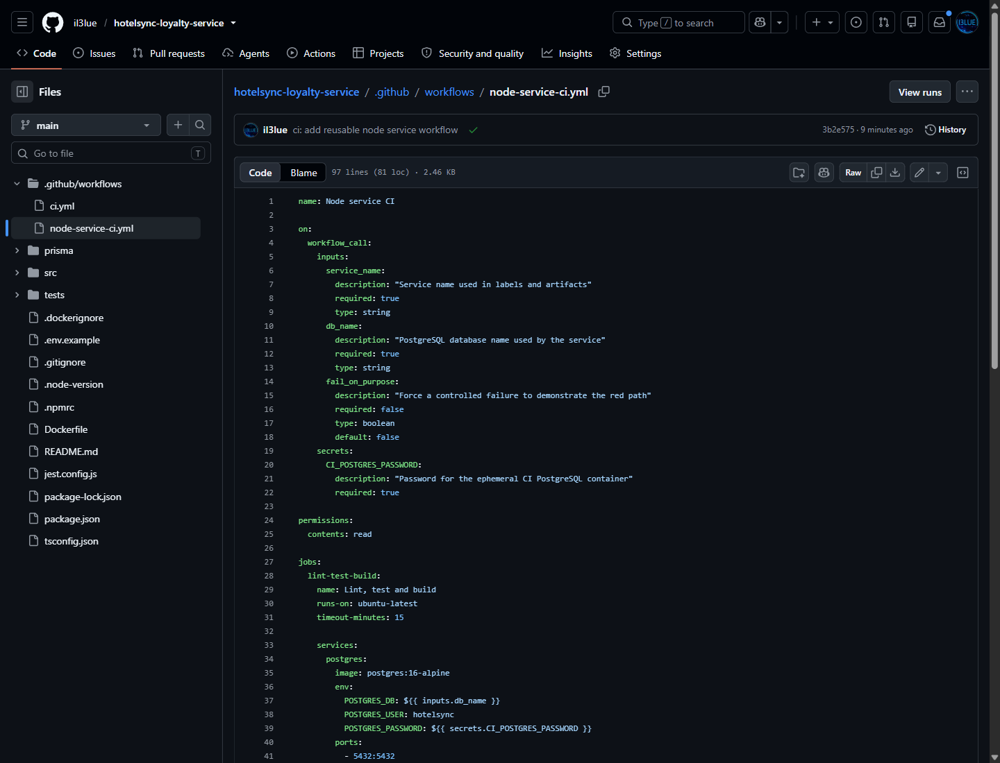
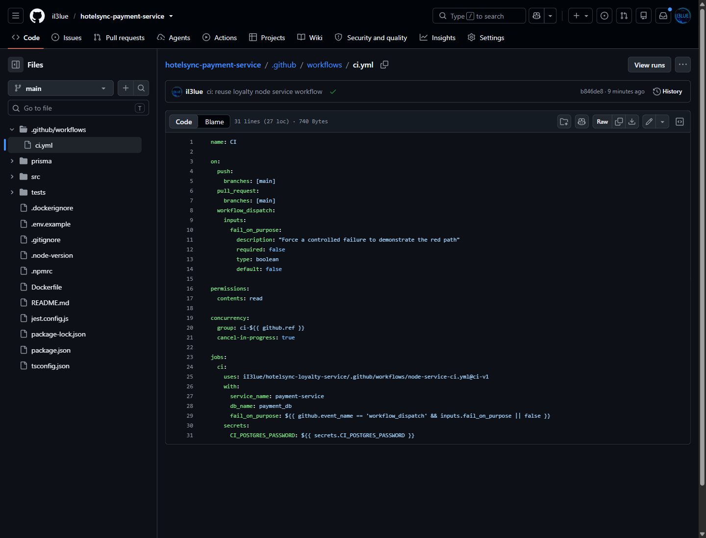
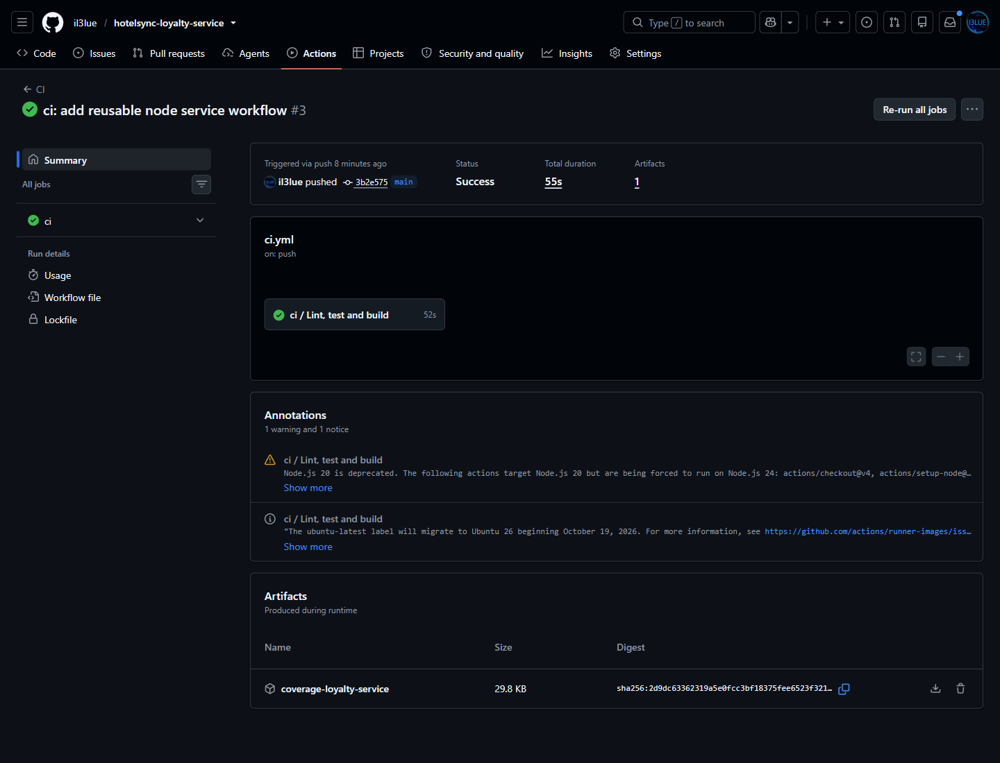
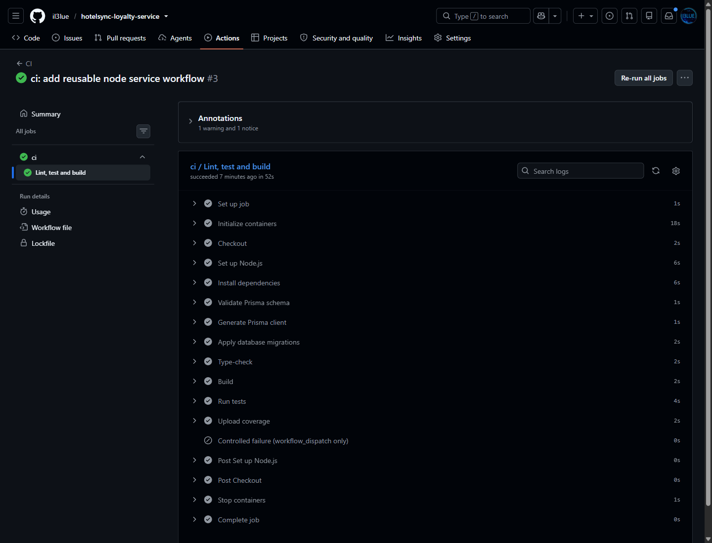
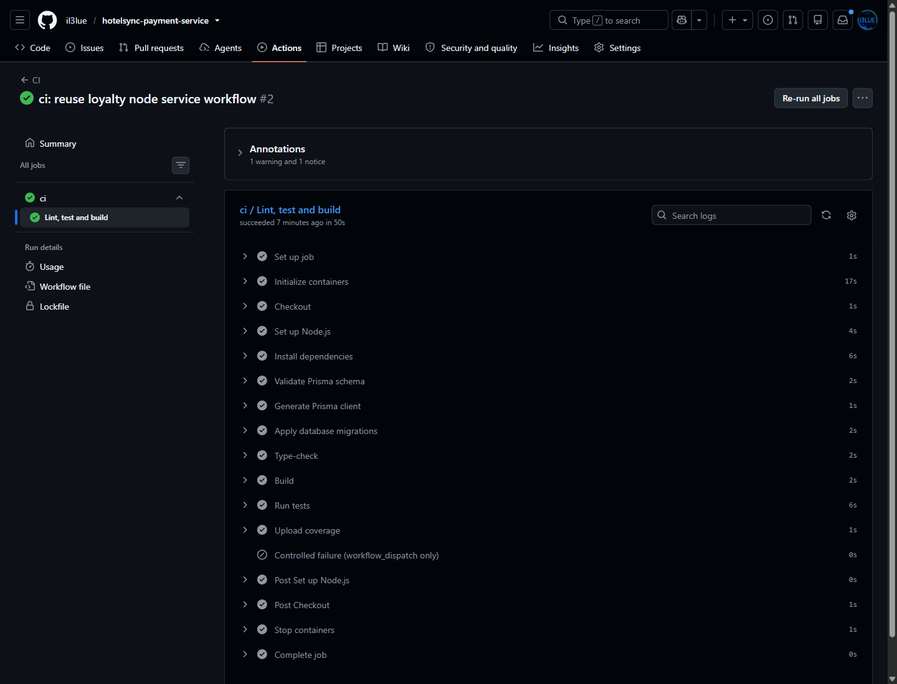
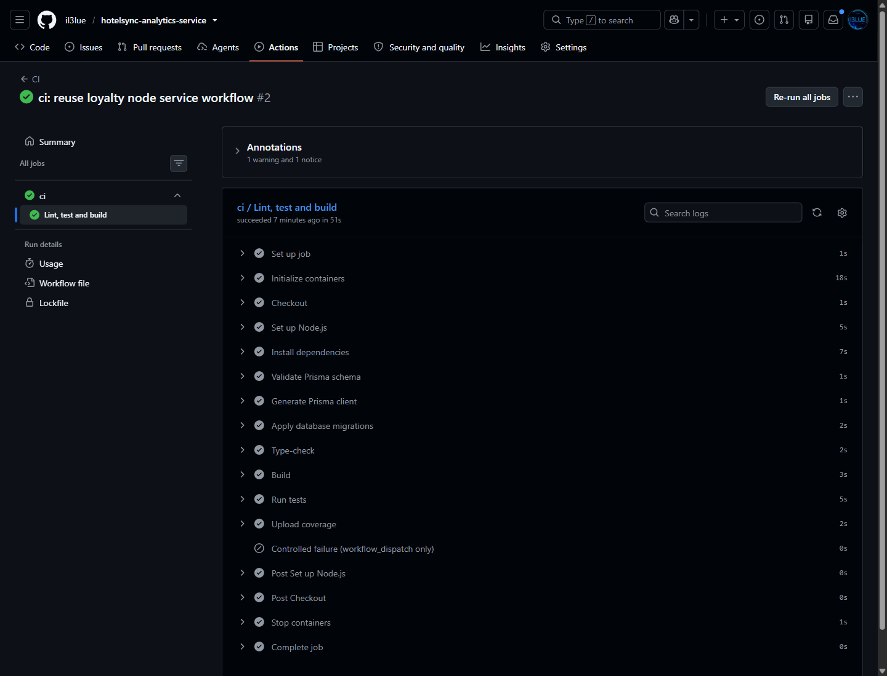
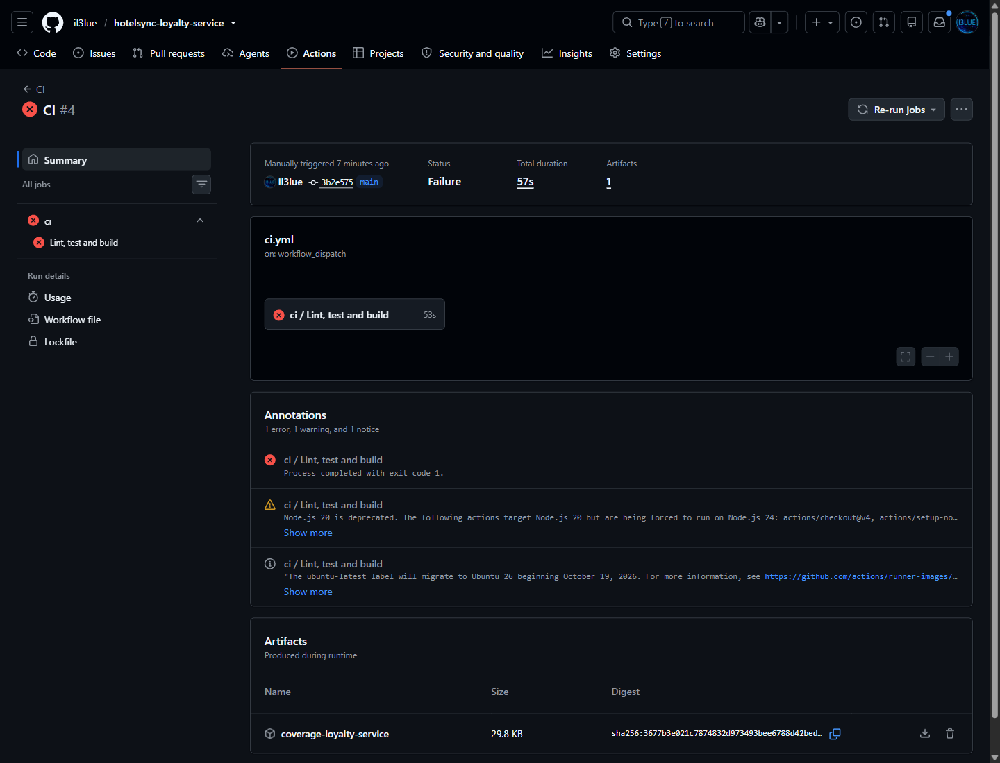
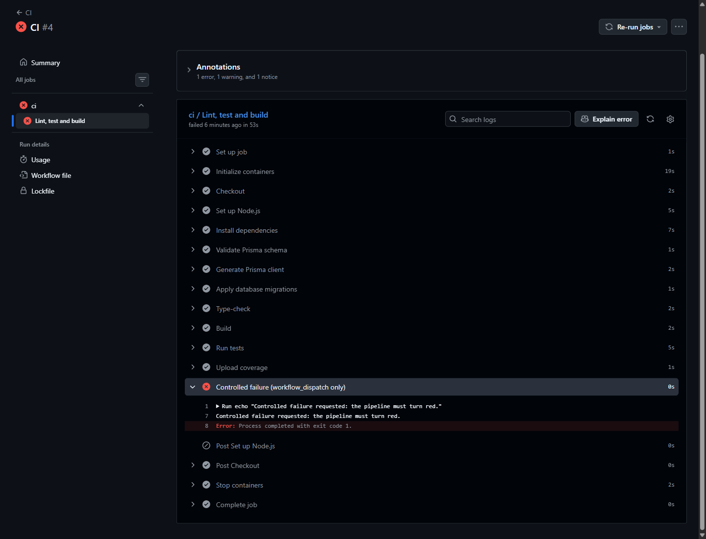

# Informe: integración continua con GitHub Actions en HotelSync

**Servicios cubiertos:** loyalty-service, payment-service, analytics-service, booking-service, user-service, rate-availability-service, property-service, housekeeping-service, front-desk-service, channel-manager y billing-service  
**Autores:** Juan Diego Díaz · María Ángel Correa · Juan Pablo Hernández · Marleidys Bautista  
**Fecha:** 27 de octubre de 2026

## 1. Contexto y objetivo

HotelSync es una plataforma de gestión hotelera organizada como monorepo de microservicios. Los once repositorios de despliegue de servicios backend no contaban con validación automática: cada cambio dependía de pruebas manuales y de la suerte del entorno local. El objetivo fue incorporar un pipeline de integración continua que verificara, en cada push y pull request, el mismo contrato de calidad: dependencias reproducibles, cliente Prisma generado, migraciones aplicables, tipos correctos, build exitoso y tests verdes. Además, el contrato debía definirse una sola vez y reutilizarse, para no editar once YAML en paralelo.

## 2. Implementación

El workflow reutilizable vive en `iI3lue/hotelsync-loyalty-service/.github/workflows/node-service-ci.yml`, declarado con `on.workflow_call`. Recibe `service_name`, `db_name`, `fail_on_purpose` y el secreto `CI_POSTGRES_PASSWORD`. Los otros diez servicios definen un `ci.yml` delgado que lo invoca fijado al tag `ci-v1`; loyalty lo invoca localmente con `./.github/workflows/node-service-ci.yml`. Fijar un tag hace que el contrato sea inmutable para los consumidores y que cada actualización sea explícita. Los pasos son: checkout con `persist-credentials: false`, Node.js 20 con caché de npm, `npm ci`, `prisma validate/generate/migrate deploy` contra un PostgreSQL 16 efímero, `tsc --noEmit`, build, Jest con cobertura y publicación del artefacto.

El workflow aplica mínimo privilegio (`contents: read`), cancela ejecuciones obsoletas con `concurrency`, limita el job a 15 minutos y no usa secretos de producción. `CI_POSTGRES_PASSWORD` se define por repositorio, es aleatorio y solo alimenta el contenedor efímero; las pruebas conservan el secreto de test que define cada servicio cuando `NODE_ENV=test`. La entrada `fail_on_purpose`, disponible solo por `workflow_dispatch`, provoca un fallo controlado para demostrar el camino rojo sin romper `main`.

Alojarlo en loyalty no fue casual: el monorepo es privado y un workflow consumido por repos públicos debe vivir en uno público. En lugar de crear un cuarto repositorio, se reutilizó loyalty y su caller local prueba que la definición sigue funcionando. El costo es el acoplamiento: si loyalty se renombra o el tag desaparece, los diez consumidores fallan; por eso el tag se trata como una versión publicada.

| Repositorio | Rol | Commit | Tests | Ejecución |
|---|---|---|---|---|
| `iI3lue/hotelsync-loyalty-service` | Define y consume localmente | `3b2e575` | 13 / 2 suites | [run 40602809001](https://github.com/iI3lue/hotelsync-loyalty-service/actions/runs/40602809001) |
| `iI3lue/hotelsync-payment-service` | Consume `@ci-v1` | `b846de8` | 48 / 4 suites | [run 40602843822](https://github.com/iI3lue/hotelsync-payment-service/actions/runs/40602843822) |
| `iI3lue/hotelsync-analytics-service` | Consume `@ci-v1` | `abc066a` | 22 / 4 suites | [run 40602844758](https://github.com/iI3lue/hotelsync-analytics-service/actions/runs/40602844758) |
| `iI3lue/hotelsync-booking-service` | Consume `@ci-v1` | `e1ed26b` | 87 / 4 suites | [run 40609956086](https://github.com/iI3lue/hotelsync-booking-service/actions/runs/40609956086) |
| `iI3lue/hotelsync-user-service` | Consume `@ci-v1` | `ff7cc4c` | 73 / 11 suites | [run 40609960627](https://github.com/iI3lue/hotelsync-user-service/actions/runs/40609960627) |
| `iI3lue/hotelsync-rate-availability-service` | Consume `@ci-v1` | `5c2846f` | 52 / 7 suites | [run 40609964817](https://github.com/iI3lue/hotelsync-rate-availability-service/actions/runs/40609964817) |
| `iI3lue/hotelsync-property-service` | Consume `@ci-v1` | `4ce8baf` | 34 / 5 suites | [run 40609971011](https://github.com/iI3lue/hotelsync-property-service/actions/runs/40609971011) |
| `iI3lue/hotelsync-housekeeping-service` | Consume `@ci-v1` | `b999820` | 20 / 2 suites | [run 40609974328](https://github.com/iI3lue/hotelsync-housekeeping-service/actions/runs/40609974328) |
| `iI3lue/hotelsync-front-desk-service` | Consume `@ci-v1` | `d8095b0` | 33 / 3 suites | [run 40609978472](https://github.com/iI3lue/hotelsync-front-desk-service/actions/runs/40609978472) |
| `iI3lue/hotelsync-channel-manager` | Consume `@ci-v1` | `64227a6` | 5 / 3 suites | [run 40609982869](https://github.com/iI3lue/hotelsync-channel-manager/actions/runs/40609982869) |
| `iI3lue/hotelsync-billing-service` | Consume `@ci-v1` | `859c51f` | 12 / 3 suites | [run 40609987306](https://github.com/iI3lue/hotelsync-billing-service/actions/runs/40609987306) |

## 3. Evidencia y resultados

El workflow se aplicó en los once repositorios del alcance. Las once ejecuciones de `main` terminaron en verde: 399 tests en 48 suites, con cobertura desde 5 tests en channel-manager hasta 87 en booking. La tabla de la sección 2 resume cada ejecución con su commit y su enlace. La ejecución fallida se generó de forma deliberada en loyalty mediante `workflow_dispatch` con `fail_on_purpose=true` ([run 40602976313](https://github.com/iI3lue/hotelsync-loyalty-service/actions/runs/40602976313)): todos los pasos de calidad pasaron y el fallo se produjo únicamente en el paso de demostración, con `exit code 1`.

El anexo incluye capturas representativas de la definición, los callers y los pasos del workflow; la tabla de la sección 2 enlaza las once ejecuciones completas.

## 4. Reflexión

La reutilización no es solo ahorro de líneas: convierte la política de calidad en un contrato ejecutable con una única fuente de verdad. Un cambio versionado del workflow se propaga a los once servicios cuando se publica un nuevo tag, pero también concentra el riesgo: un error en la definición puede romper once pipelines simultáneamente. La decisión de fijar `ci-v1`, mantener un caller local en loyalty y comprobar `referenced_workflows` al validar cada ejecución convierte ese riesgo en algo visible y controlado. Copiar el YAML once veces habría dado independencia, pero habría garantizado divergencia silenciosa.

El ejercicio también mostró que el aislamiento importa. En payment, los tests firman tokens con el secreto de test que el propio código usa cuando `NODE_ENV=test`; definir `AUTH_JWT_SECRET` a nivel de job hacía que todos los requests devolvieran 401. La lección fue separar configuración de build, migración y test, y no “arreglar” un fallo globalizando variables. Del mismo modo, el health check de PostgreSQL debe indicar usuario y base (`pg_isready -U … -d …`) para evitar falsos positivos.

La migración también expuso un acoplamiento oculto: rate-availability, property y front-desk importaban en sus tests un helper de tokens de user-service mediante una ruta relativa que solo existe en el monorepo. En los splits esa ruta no resuelve y Jest falla con `TS2307`. La corrección fue mover un helper local a `tests/helpers/tokens.ts`, con el mismo contrato HS256 y el mismo fallback de test, para que cada repositorio sea autónomo. Un test que depende del código fuente de otro servicio no prueba un split independiente.

Finalmente, el fallo controlado valida el camino rojo: un pipeline que nunca falla no demuestra nada. Tener una forma explícita y auditable de provocar el error permite comprobar diagnóstico y tiempos de reacción sin introducir un bug real en `main`.

## 5. Limitaciones y próximos pasos

Los tests de estos repositorios mockean Prisma y los clientes HTTP, por lo que la CI valida contratos y migraciones, pero no un E2E contra la base real. Tampoco hay umbral de cobertura ni despliegue automático: Render y Vercel siguen desplegando por su propia integración. GitHub advierte que `actions/checkout@v4`, `setup-node@v4` y `upload-artifact@v4` apuntan a Node.js 20, así que corresponde actualizarlos. Como siguientes pasos: cobertura mínima, protección de rama que exija el check, notificaciones cuando falle `main` e incorporar el frontend Next.js y el monorepo, que quedan fuera del alcance de los once servicios backend.

## Anexo: evidencias de ejecución

Capturas tomadas de las ejecuciones reales de GitHub Actions. La tabla de la sección 2 enlaza las once ejecuciones y las páginas 1 y 2 contienen el informe de reflexión. Las figuras muestran la definición reutilizable, los callers y los pasos de las ejecuciones principales.

{width=15cm}

{width=15cm}

{width=15cm}

{width=15cm}

{width=15cm}

{width=15cm}

{width=15cm}

{width=15cm}
