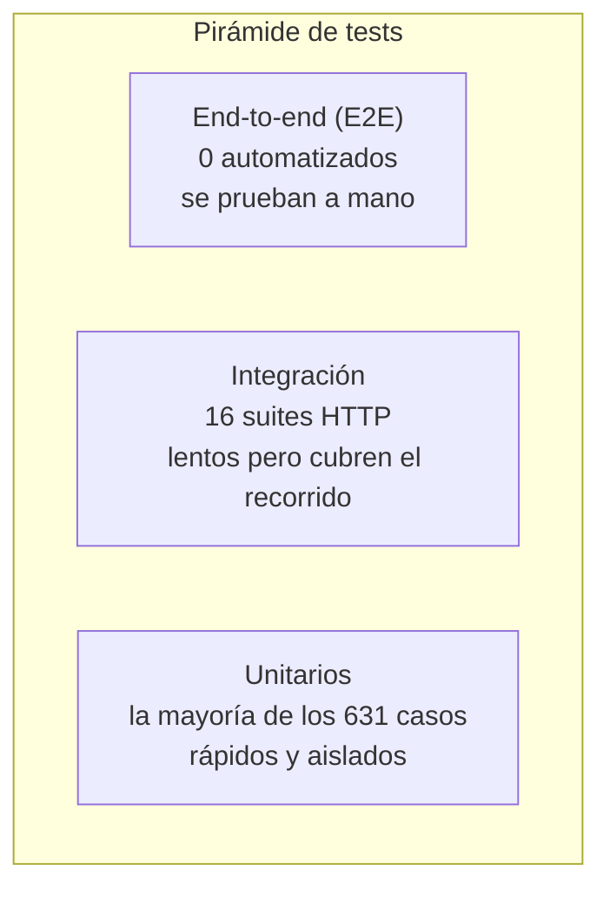
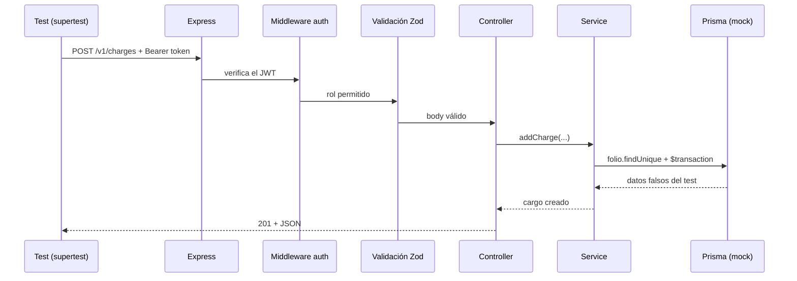

# Guía de tests de HotelSync — para quien nunca escribió uno

Esta guía explica qué son los tests, para qué sirven y cómo están escritos en este
proyecto. No asume que hayas escrito un test antes. Todos los ejemplos salen del
código real de HotelSync; podés abrirlos y leerlos completos.

Estado del proyecto al escribir esto: **736 casos automatizados, todos en verde**
(631 en los 12 microservicios y 105 en el front). El detalle del inventario está en
`docs/tests-integracion-2026-11-14.md`.

---

## Índice

1. [El problema que resuelven los tests](#1-el-problema-que-resuelven-los-tests)
2. [La idea en tres pasos](#2-la-idea-en-tres-pasos)
3. [Vocabulario mínimo](#3-vocabulario-mínimo)
4. [Qué NO garantiza un test](#4-qué-no-garantiza-un-test)
5. [Unitario vs integración](#5-unitario-vs-integración)
6. [La pirámide en HotelSync](#6-la-pirámide-en-hotelsync)
7. [El mock: un doble de riesgo para la base de datos](#7-el-mock-un-doble-de-riesgo-para-la-base-de-datos)
8. [Dónde viven los tests](#8-dónde-viven-los-tests)
9. [Quién prueba qué](#9-quién-prueba-qué)
10. [Caso de estudio 1: un test unitario puro](#10-caso-de-estudio-1-un-test-unitario-puro)
11. [Caso de estudio 2: un test unitario con mock](#11-caso-de-estudio-2-un-test-unitario-con-mock)
12. [Caso de estudio 3: un test de integración HTTP](#12-caso-de-estudio-3-un-test-de-integración-http)
13. [Los cuatro verbos y los `expect` más usados](#13-los-cuatro-verbos-y-los-expect-más-usados)
14. [Cómo leer la salida de Jest](#14-cómo-leer-la-salida-de-jest)
15. [Cómo correr los tests](#15-cómo-correr-los-tests)
16. [Ejercicio guiado](#16-ejercicio-guiado)
17. [Errores típicos del primer test](#17-errores-típicos-del-primer-test)
18. [Checklist para escribir un test nuevo](#18-checklist-para-escribir-un-test-nuevo)
19. [Casos reales que enseñaron algo](#19-casos-reales-que-enseñaron-algo)
20. [Glosario ampliado y para seguir leyendo](#20-glosario-ampliado-y-para-seguir-leyendo)

---

## 1. El problema que resuelven los tests

Imaginá que el cálculo de impuestos de facturación funciona bien. Un día alguien
"mejora" una función para redondear precios y, sin darse cuenta, rompe la factura
de todos los hoteles de México. Nadie lo nota hasta que un huésped reclama.

Los tests existen para que ese error aparezca **en tu computadora, en segundos**, y
no en producción, en días. Son una red de seguridad: si tocás algo y rompés una
regla del negocio, un test se pone rojo y te avisa.

Analogía: antes de despegar, un avión recorre una lista de verificaciones. No es
porque los ingenieros desconfíen del avión; es porque un error en el aire es
mucho más caro que un error en tierra. Un test es una verificación en tierra.

Un test, en su forma más simple, hace tres cosas:

1. **Prepara** una situación.
2. **Ejecuta** la acción que querés probar.
3. **Verifica** que el resultado sea el esperado.

Si falta cualquiera de las tres, no es un test: es un experimento.

---

## 2. La idea en tres pasos

Este patrón se llama **AAA** (*Arrange, Act, Assert*): preparar, actuar, verificar.

Ejemplo cotidiano: probar que una cerradura funciona.

- **Preparar**: conseguís la llave correcta.
- **Actuar**: girás la llave.
- **Verificar**: la puerta se abre.

En código se ve así (`services/billing-service/tests/unit/tax.test.ts:3-8`):

```ts
describe("tax", () => {
  it("should return the configured rate per country", () => {
    // Preparar: no hay nada que preparar, la función es pura.

    // Actuar: llamamos a la función con un país.
    const rate = taxRateForCountry("CO");

    // Verificar: el resultado debe ser 19%.
    expect(rate).toBe(0.19);
  });
});
```

Este test no necesita base de datos, ni red, ni servidor. Solo llama a una función
y compara el resultado. Es el tipo de test más simple que existe y, aun así,
protege una regla del negocio: Colombia cobra 19% de impuesto.

---

## 3. Vocabulario mínimo

| Término | Qué significa | Dónde aparece en HotelSync |
|---|---|---|
| **Test** | Una verificación automática: preparar, actuar, verificar. | Cada bloque `it(...)` |
| **Caso de prueba** | Un test concreto, con un resultado esperado. | `it("rechaza a un GUEST (403)", ...)` |
| **Suite** | Un grupo de tests relacionados. | Cada bloque `describe(...)` y cada archivo |
| **Assert / aserción** | La comparación que falla si algo no cumple. | `expect(res.status).toBe(200)` |
| **Mock** | Un reemplazo falso de una pieza real (por ejemplo, la base de datos). | `jest.mock("../../src/lib/prisma.js", ...)` |
| **Fixture** | Un dato de ejemplo que se usa en varios tests. | La función `user()` en `user-service/tests/integration/auth.test.ts` |
| **Cobertura** | Qué porcentaje del código fue ejecutado por los tests. | `npx jest --coverage` |
| **Regresión** | Un error que vuelve: algo que funcionaba y se rompió. | Lo que un test evita |
| **Flaky** | Un test que a veces pasa y a veces falla sin que cambie el código. | Pasó una vez en `rate-availability-service` bajo carga |
| **CI** | Integración continua: los tests corren solos en cada push. | `.github/workflows/ci.yml:138-139` |

No hace falta memorizarlos ahora. La guía los vuelve a usar con ejemplos.

---

## 4. Qué NO garantiza un test

Esto es importante para no confiar de más:

- **No prueba que el sistema entero funcione.** Un test puede pasar y la app
  romperse por una configuración, una migración o una integración entre servicios.
- **No reemplaza probar a mano.** En HotelSync los flujos completos (registrarse,
  reservar, hacer check-in) se prueban manualmente contra la app real.
- **No mide si el código es bueno o legible.** Un test verde no significa código
  limpio.
- **No encuentra todos los errores.** En este proyecto Prisma está simulado
  (mockeado), así que un test no detecta un error de SQL ni una restricción de la
  base de datos.

Un test es una herramienta, no una garantía absoluta.

---

## 5. Unitario vs integración

HotelSync usa dos tipos de test.

### Test unitario

Prueba **una sola pieza aislada**: una función, un servicio, una regla de negocio.
Todo lo externo (base de datos, otros servicios, red) se reemplaza por un mock.

Analogía: probar el motor de un auto en un banco de pruebas, sin el auto alrededor.
Si falla, sabés que el problema está en el motor.

Ejemplo: `housekeepingService.listMine` debe filtrar las tareas por el usuario del
token. El test no levanta un servidor ni una base: llama al servicio y revisa qué
consulta habría hecho.

### Test de integración

Prueba **varias piezas juntas**, normalmente a través de HTTP: ruta, middleware de
autenticación, validación con Zod, controlador, servicio y manejo de errores. La
base de datos sigue mockeada.

Analogía: probar el auto completo en una pista corta. El motor es real, las ruedas
son reales y el volante también, pero no hay tráfico.

Ejemplo: `POST /v1/charges` debe responder 401 sin token, 403 si el usuario es
GUEST, 409 si el folio está cerrado y 201 si todo está bien.

| | Unitario | Integración |
|---|---|---|
| Qué prueba | Una pieza | El recorrido HTTP completo |
| Velocidad | Muy rápido | Rápido, pero más lento |
| Qué se mockea | Todo lo externo | La base de datos y los servicios externos |
| Qué error detecta | Lógica de negocio | Autenticación, validación, códigos HTTP, contratos |
| Dónde vive | `tests/unit/` | `tests/integration/` |

La regla del curso que motivó este trabajo: **mínimo 2 tests unitarios y 1 de
integración por microservicio**. Hoy los 12 servicios lo cumplen.

---

## 6. La pirámide en HotelSync



Por qué esta forma:

- **Muchos unitarios**: son baratos, rápidos y señalan exactamente qué pieza falló.
- **Menos integración**: cubren lo que el unitario no ve (auth, Zod, códigos HTTP).
- **Cero E2E automatizados**: levantar los 12 servicios, 12 bases y RabbitMQ en CI
  es caro y frágil para un proyecto académico. Esos flujos se prueban manualmente.

No es una regla universal: es la decisión de este proyecto, con este presupuesto.

---

## 7. El mock: un doble de riesgo para la base de datos

Un **mock** es una pieza falsa que se comporta como la real solo para el test.

Cuando el código hace `prisma.folio.findUnique(...)`, en producción eso va a
PostgreSQL. En un test, `jest.mock` reemplaza `prisma` por un objeto falso cuyos
métodos son funciones controladas por el test:

```ts
jest.mock("../../src/lib/prisma.js", () => ({
  __esModule: true,
  default: {
    folio: { findUnique: jest.fn() },
    $transaction: jest.fn(),
  },
}));
```

Traducción: "cuando alguien importe la base de datos, dale este objeto falso en su
lugar". Cada `jest.fn()` es una función vacía que el test puede programar:

```ts
mockPrisma.folio.findUnique.mockResolvedValue({ status: "closed" });
```

Eso significa: "cuando el código pregunte por un folio, respondé que está cerrado".
Y después se puede verificar qué se llamó:

```ts
expect(mockPrisma.folio.findUnique).toHaveBeenCalledWith({
  where: { folio_id: FOLIO_ID },
});
```

### Reglas del mock en este proyecto

1. **Se declara arriba, antes de los imports.** Jest "iza" (`hoists`) los
   `jest.mock` al principio del archivo. Por eso los `import` del código real van
   *después* del mock.
2. **`__esModule: true` y `default`** son necesarios porque el Prisma real se
   exporta como export default.
3. **Solo se mockea lo externo.** Nunca se mockea la función que se quiere probar;
   si lo hacés, el test pasa siempre y no prueba nada.
4. **La transacción también se mockea.** El código real usa
   `prisma.$transaction(async (tx) => ...)`. En los tests se simula así:

```ts
mockPrisma.$transaction.mockImplementation((cb: any) => cb(tx));
```

Es decir: "ejecutá el callback con este `tx` falso", para que el código corra
igual que en producción pero sin base de datos.

### Qué se pierde con el mock

El test no valida SQL, ni tipos de columna, ni `UNIQUE`, ni `FOREIGN KEY`. Eso se
cubre con migraciones, la base real y las pruebas manuales. Es un intercambio
consciente: se gana velocidad y determinismo; se pierde realismo de la base.

---

## 8. Dónde viven los tests

Cada microservicio es independiente, y también lo son sus tests:

```
services/billing-service/
  src/                         código de producción
    routes/
    controllers/
    services/
    middleware/
  tests/
    unit/                      pruebas de piezas aisladas
      tax.test.ts
      consumer.test.ts
      folio-by-booking.test.ts
      gateway.test.ts
    integration/               pruebas HTTP
      folios.test.ts
    helpers/
      tokens.ts                firma de JWT para los tests
  jest.config.js               configuración de Jest del servicio
  tsconfig.json                excluye tests/ del build de producción
```

Por qué un `jest.config.js` por servicio y no uno global: cada servicio se
despliega solo (un repo, un deploy). Sus tests deben poder correr sin depender del
resto del monorepo.

`jest.config.js` es siempre el mismo y pequeño:

```js
module.exports = {
  preset: "ts-jest",
  testEnvironment: "node",
  roots: ["<rootDir>/tests"],
  testMatch: ["**/*.test.ts"],
  moduleNameMapper: {
    "^(\\.{1,2}/.*)\\.js$": "$1",
  },
};
```

- `ts-jest` ejecuta TypeScript directamente, sin compilar a mano.
- `testEnvironment: "node"` porque son servicios de backend, no navegador.
- `moduleNameMapper` permite importar `.../archivo.js` (estilo ESM) desde tests.

Ese es el común denominador. La única excepción es `analytics-service`, que agrega
`setupFiles: ["<rootDir>/tests/setup.ts"]` para definir variables de entorno
**antes** de importar el código:

```ts
process.env.NODE_ENV = "test";
process.env.AUTH_JWT_SECRET = process.env.AUTH_JWT_SECRET ?? "analytics-test-secret";
```

Ese orden importa: si el módulo lee `process.env` al cargarse, la variable debe
existir antes del `import`.

El `tsconfig.json` de cada servicio **excluye** `tests/`, así que el build de
producción no incluye código de test. El chequeo de tipos de los tests lo hace
`ts-jest` al ejecutarlos.

---

## 9. Quién prueba qué

Números reales de la última corrida completa (`npm test -- --runInBand`).

| Servicio | Suites unit | Suites integración | Casos | Qué protege |
|---|---|---|---|---|
| analytics | 4 | 1 | 35 | ETL idempotente, métricas, scheduler |
| api-gateway | 2 | 4 | 65 | Rutas proxeadas, seguridad de borde, health |
| billing | 4 | 1 | 33 | Folios, cargos, facturas, impuestos, outbox |
| booking | 4 | 1 | 96 | Reservas, versión optimista, pagos, eventos |
| channel-manager | 4 | 1 | 19 | Simulador de OTAs, broker, consumidor |
| front-desk | 3 | 1 | 42 | Check-in/check-out, requisitos de reserva |
| housekeeping | 3 | 1 | 41 | Tareas de limpieza, estados de habitación |
| loyalty | 3 | 1 | 33 | Puntos, niveles, canje, reverso |
| payment | 4 | 1 | 57 | Cobros, reintentos, reembolsos, gateway mock |
| property | 5 | 2 | 48 | Hoteles, habitaciones, políticas de cancelación |
| rate-availability | 8 | 1 | 71 | Tarifas, inventario, disponibilidad, caché |
| user | 12 | 1 | 91 | Registro, login, sesiones, roles, baja |
| **apps/front** | 11 | 0 | 105 | Cliente de API, formato, timeouts, auth |

Las suites de integración nuevas (billing, housekeeping, loyalty, user) se agregaron
para cumplir el mínimo de una integración por microservicio. Antes solo 8 de 12
servicios la tenían.

---

## 10. Caso de estudio 1: un test unitario puro

Archivo completo: `services/billing-service/tests/unit/tax.test.ts` (25 líneas).

```ts
import { taxRateForCountry, round2 } from "../../src/lib/tax.js";

describe("tax", () => {
  it("should return the configured rate per country", () => {
    expect(taxRateForCountry("CO")).toBe(0.19);
    expect(taxRateForCountry("co")).toBe(0.19);
    expect(taxRateForCountry("AR")).toBe(0.21);
  });

  it("should accept country names as stored by Property", () => {
    expect(taxRateForCountry("Argentina")).toBe(0.21);
    expect(taxRateForCountry("Colombia")).toBe(0.19);
    expect(taxRateForCountry("México")).toBe(0.16);
  });

  it("should return 0 for unknown or missing country", () => {
    expect(taxRateForCountry("XX")).toBe(0);
    expect(taxRateForCountry(undefined)).toBe(0);
  });

  it("should round to 2 decimals", () => {
    expect(round2(10.005)).toBe(10.01);
    expect(round2(25500)).toBe(25500);
  });
});
```

Leído en voz alta:

- `describe("tax", ...)` agrupa los tests de impuestos.
- `it("should return the configured rate per country", ...)` describe **una regla**
  en lenguaje humano.
- Cada `expect(...).toBe(...)` es una afirmación: "esto debe ser exactamente aquello".

Qué protege:

- Que Colombia cobre 19%, Argentina 21% y México 16%.
- Que funcione con código de país (`"CO"`) y con nombre (`"Colombia"`).
- Que un país desconocido no explote: devuelve 0.
- Que el redondeo sea a dos decimales.

Si alguien cambia el redondeo y rompe facturación, este test se pone rojo.

Por qué es unitario puro: la función no toca base de datos, ni red, ni archivos.
Entra un valor, sale un valor. El test no necesita preparar nada.

---

## 11. Caso de estudio 2: un test unitario con mock

Ahora una pieza que **sí** habla con la base de datos:
`housekeepingService.listMine` (`services/housekeeping-service/src/services/housekeeping.service.ts:55-63`).

```ts
async listMine(userId: string, query: ListMineQuery) {
  return prisma.cleaningHistory.findMany({
    where: {
      assigned_to_user_id: userId,
      ...(query.status ? { status: query.status } : {}),
    },
    orderBy: { created_at: "asc" },
  });
}
```

La regla: un housekeeper solo ve **sus** tareas, y opcionalmente filtradas por
estado.

El test (`services/housekeeping-service/tests/unit/housekeeping.service.test.ts:52-73`)
hace esto:

```ts
describe("listMine", () => {
  it("filters tasks by the authenticated user", async () => {
    mockPrisma.cleaningHistory.findMany.mockResolvedValue([]);

    await housekeepingService.listMine(USER_ID, {});

    expect(mockPrisma.cleaningHistory.findMany).toHaveBeenCalledWith({
      where: { assigned_to_user_id: USER_ID },
      orderBy: { created_at: "asc" },
    });
  });
});
```

Desarmemos el flujo:

1. **Preparar**: `mockResolvedValue([])` dice "cuando consulten, devolvé una lista
   vacía". No hace falta una base real.
2. **Actuar**: `await housekeepingService.listMine(USER_ID, {})` ejecuta la función
   real.
3. **Verificar**: `toHaveBeenCalledWith` revisa **qué consulta se hizo**. El test no
   mira el resultado (la lista vacía), mira el filtro: que haya usado el `USER_ID`
   recibido y no otro.

Ese detalle es la esencia del test: si alguien borra el `where`, el test falla
aunque la función "funcione" sin error.

También se prueba el error de negocio
(`tests/unit/housekeeping.service.test.ts:93-107`):

```ts
it("rejects assigning a non-pending task", async () => {
  mockPrisma.cleaningHistory.findUnique.mockResolvedValue({
    history_id: TASK_ID,
    status: "done",
  });

  await expect(
    housekeepingService.assignTask(
      TASK_ID,
      { assigned_to_user_id: USER_ID },
      actor("MANAGER")
    )
  ).rejects.toThrow(AppError);

  expect(mockPrisma.cleaningHistory.update).not.toHaveBeenCalled();
});
```

Dos aprendizajes:

- `rejects.toThrow(AppError)`: cuando el código lanza un error, el test lo espera
  con `rejects`, no con `expect(...).toBe(...)`.
- `not.toHaveBeenCalled()`: verifica que **no** se escribió en la base. Un manejo de
  error correcto no debe dejar efectos a medias.

---

## 12. Caso de estudio 3: un test de integración HTTP

Archivo: `services/billing-service/tests/integration/folios.test.ts`. Prueba dos
rutas reales: `POST /v1/charges` y `POST /v1/folios/:id/close`.

### El recorrido que se prueba



### Los seis pasos del patrón

**Paso 1. Mockear lo externo, antes de los imports.**

```ts
jest.mock("../../src/lib/prisma.js", () => ({
  __esModule: true,
  default: {
    folio: { findUnique: jest.fn() },
    $transaction: jest.fn(),
  },
}));
```

**Paso 2. Armar una app Express mínima** con solo lo que se prueba:

```ts
const app = express();
app.use(express.json());
app.use("/v1/charges", chargesRouter);
app.use("/v1/folios", foliosRouter);
app.use(errorHandler);
```

Es la misma app que en producción, pero sin el middleware del gateway ni el
`listen`. Se puede probar sin abrir un puerto.

**Paso 3. Firmar un token real.** `tests/helpers/tokens.ts` arma un JWT HS256 con
el mismo contrato que `user-service`:

```ts
const tokenFor = (role: string, hotel_id: string | null) =>
  signAccessToken({ sub: STAFF_SUB, email: "staff@hotelsync.local", role, hotel_id });
```

No se mockea la autenticación: se usa un token válido de verdad. Así el test
también cubre el middleware de auth.

**Paso 4. Hacer la petición.**

```ts
const res = await request(app)
  .post("/v1/charges")
  .set("Authorization", `Bearer ${tokenFor("RECEPTIONIST", HOTEL_A)}`)
  .send({ folio_id: FOLIO_ID, concept: "Minibar", amount: 50 });
```

**Paso 5. Verificar el contrato HTTP.**

```ts
expect(res.status).toBe(201);
expect(res.body.charge_id).toBe("ch-1");
```

**Paso 6. Verificar los efectos internos.**

```ts
expect(tx.folio.update).toHaveBeenCalledWith(
  expect.objectContaining({
    where: { folio_id: FOLIO_ID },
    data: { total: 150 },
  })
);
```

### Por qué se prueban estos casos y no otros

Cada caso representa una regla distinta, no una variación cosmética:

| Caso | Regla que protege |
|---|---|
| 401 sin token | Nadie entra sin autenticarse |
| 403 GUEST | Solo staff de facturación agrega cargos |
| 400 monto negativo | Zod rechaza datos inválidos antes del servicio |
| 404 folio inexistente | No se inventan folios |
| 409 folio cerrado | Un folio cerrado no acepta cargos |
| 403 otro hotel | Un manager no toca folios de otro hotel |
| 201 + total 150 | El cargo se crea y el total del folio se sincroniza |
| 200 cierre idempotente | Cerrar dos veces no duplica la factura |
| 200 cierre | Se crea la factura y se encola `folio.closed` en la misma transacción |

Ese último caso es un buen ejemplo de regla no obvia: el cierre es **idempotente**
(se puede repetir sin efecto). No devuelve 409; devuelve la factura ya existente.

---

## 13. Los cuatro verbos y los `expect` más usados

| Verbo | Para qué | Ejemplo real |
|---|---|---|
| `describe` | Agrupar tests de una misma pieza | `describe("POST /v1/charges", ...)` |
| `it` | Un caso, una regla | `it("rechaza a un GUEST (403)", ...)` |
| `expect` | La afirmación | `expect(res.status).toBe(403)` |
| `mockResolvedValue` | Programar el mock | `mockPrisma.folio.findUnique.mockResolvedValue(null)` |

| `expect` | Qué compara | Ejemplo |
|---|---|---|
| `toBe` | Igualdad exacta (números, strings, booleanos) | `expect(res.status).toBe(200)` |
| `toEqual` | Igualdad profunda (objetos, arreglos) | `expect(res.body.data).toEqual([])` |
| `toHaveBeenCalledWith` | Con qué argumentos se llamó al mock | `expect(tx.roomStatus.update).toHaveBeenCalledWith({...})` |
| `not.toHaveBeenCalled` | Que no hubo efecto | `expect(tx.charge.create).not.toHaveBeenCalled()` |
| `rejects.toThrow` | Que una promesa falla | `await expect(fn()).rejects.toThrow(AppError)` |
| `toContain` | Que un arreglo o string contiene algo | `expect(tiers).toContain("gold")` |

Regla práctica: `toBe` para valores simples; `toEqual` para objetos y listas.

---

## 14. Cómo leer la salida de Jest

Al correr los tests vas a ver algo así:

```
PASS tests/integration/folios.test.ts (16.191 s)
PASS tests/unit/tax.test.ts
PASS tests/unit/consumer.test.ts
  ● Console
    console.warn
      [consumer] routing key ignorada: booking.created

Test Suites: 5 passed, 5 total
Tests:       33 passed, 33 total
Snapshots:   0 total
Time:        21.938 s
```

- `PASS` / `FAIL`: si el archivo entero pasó o no.
- `● Console`: mensajes que el código imprimió durante el test. No son errores.
- `Test Suites`: archivos de test.
- `Tests`: casos individuales (`it`).

Cuando algo falla, Jest muestra el archivo, la línea, el valor esperado y el
recibido:

```
● POST /v1/charges › devuelve 409 si el folio no está abierto

  expect(received).toBe(expected)

  Expected: 409
  Received: 201
```

Se lee: "se esperaba 409, llegó 201". Casi siempre eso alcanza para saber qué regla
se rompió.

---

## 15. Cómo correr los tests

Desde la raíz del monorepo:

```powershell
# Todos los servicios y el front
npm test -- --runInBand

# Un servicio puntual
npm test --workspace=services/billing-service -- --runInBand
```

Dentro de la carpeta de un servicio:

```powershell
# Todos los tests del servicio
npx jest --runInBand

# Un archivo
npx jest --runInBand tests/integration/folios.test.ts

# Un caso por nombre
npx jest --runInBand -t "devuelve 409"

# Cobertura (genera coverage/)
npx jest --runInBand --coverage
```

`--runInBand` hace que Jest corra los tests en serie. En Windows evita problemas de
memoria y de workers; es la forma recomendada en este proyecto.

En CI (`.github/workflows/ci.yml:138-139`) se ejecuta:

```yaml
- name: Run tests
  run: npm test --workspaces --if-present
```

Es decir: cada push corre los tests de todos los workspaces. Si uno falla, el
pipeline falla.

---

## 16. Ejercicio guiado

Objetivo: escribir el test de integración de `GET /v1/rooms/status` en
housekeeping. No mires la solución hasta intentarlo.

### Lo que ya sabés del código

- Ruta: `services/housekeeping-service/src/routes/rooms.ts`.
- Requiere token (`requireAuth`).
- Roles permitidos: `HOUSEKEEPER`, `MANAGER`, `SUPER_ADMIN`.
- Valida el query con Zod: `hotel_id` debe ser UUID.
- El servicio (`listRoomStatus`) exige que el actor sea del mismo hotel, salvo
  SUPER_ADMIN, y consulta `prisma.roomStatus.findMany`.

### Casos que debe cubrir

1. Sin token devuelve 401.
2. Un GUEST devuelve 403.
3. Sin `hotel_id` devuelve 400 (validación).
4. Un MANAGER del hotel devuelve 200 y consulta su hotel.
5. Un MANAGER de otro hotel devuelve 403.

### Pistas

- El mock de Prisma necesita `roomStatus.findMany`.
- El token se firma con `signAccessToken` de `tests/helpers/tokens.ts`.
- Montá el router en una app local: `app.use("/v1/rooms", roomsRouter)`.
- Para el caso 4, verificá `findMany` con `where: { hotel_id: HOTEL_A }`.

<details>
<summary>Ver una solución posible</summary>

```ts
import request from "supertest";
import express from "express";
import roomsRouter from "../../src/routes/rooms.js";
import { errorHandler } from "../../src/middleware/error-handler.js";

jest.mock("../../src/lib/prisma.js", () => ({
  __esModule: true,
  default: { roomStatus: { findMany: jest.fn() } },
}));

import prisma from "../../src/lib/prisma.js";
import { signAccessToken } from "../helpers/tokens.js";

const mockPrisma = prisma as any;

const HOTEL_A = "a1b2c3d4-e5f6-4890-abcd-ef1234567890";
const HOTEL_B = "b1b2c3d4-e5f6-4890-abcd-ef1234567891";

const STAFF_SUB = "11111111-2222-4333-8444-555555555555";

const tokenFor = (role: string, hotel_id: string | null) =>
  signAccessToken({ sub: STAFF_SUB, email: "u@hotelsync.local", role, hotel_id });

const app = express();
app.use(express.json());
app.use("/v1/rooms", roomsRouter);
app.use(errorHandler);

beforeEach(() => jest.clearAllMocks());

describe("GET /v1/rooms/status", () => {
  it("rechaza sin token (401)", async () => {
    const res = await request(app).get(`/v1/rooms/status?hotel_id=${HOTEL_A}`);
    expect(res.status).toBe(401);
  });

  it("rechaza a un GUEST (403)", async () => {
    const res = await request(app)
      .get(`/v1/rooms/status?hotel_id=${HOTEL_A}`)
      .set("Authorization", `Bearer ${tokenFor("GUEST", null)}`);
    expect(res.status).toBe(403);
  });

  it("rechaza un hotel_id que no es UUID (400)", async () => {
    const res = await request(app)
      .get("/v1/rooms/status?hotel_id=no-es-uuid")
      .set("Authorization", `Bearer ${tokenFor("MANAGER", HOTEL_A)}`);
    expect(res.status).toBe(400);
  });

  it("devuelve las habitaciones del hotel del manager (200)", async () => {
    mockPrisma.roomStatus.findMany.mockResolvedValue([]);
    const res = await request(app)
      .get(`/v1/rooms/status?hotel_id=${HOTEL_A}`)
      .set("Authorization", `Bearer ${tokenFor("MANAGER", HOTEL_A)}`);

    expect(res.status).toBe(200);
    expect(mockPrisma.roomStatus.findMany).toHaveBeenCalledWith(
      expect.objectContaining({ where: { hotel_id: HOTEL_A } })
    );
  });

  it("rechaza al manager de otro hotel (403)", async () => {
    const res = await request(app)
      .get(`/v1/rooms/status?hotel_id=${HOTEL_A}`)
      .set("Authorization", `Bearer ${tokenFor("MANAGER", HOTEL_B)}`);
    expect(res.status).toBe(403);
  });
});
```

</details>

Después de escribirlo, corré:

```powershell
npx jest --runInBand tests/integration/rooms.test.ts
```

---

## 17. Errores típicos del primer test

| Síntoma | Causa | Arreglo |
|---|---|---|
| El mock no se aplica y el test intenta conectarse a la base | El `jest.mock` está después de los `import` | Poner `jest.mock` antes de importar el código real |
| `TypeError: prisma.X is not a function` | El mock no define ese modelo o método | Agregar la propiedad exacta al objeto del mock |
| El test pasa aunque borres la validación | Se mockeó justo lo que se quería probar | Mockear solo lo externo (Prisma, HTTP), nunca el servicio o middleware bajo prueba |
| 401 inesperado en integración | Token firmado con otro secreto o con `sub` que no es UUID | Usar el helper `signAccessToken` y UUIDs reales |
| El test pasa solo o falla solo | Depende del orden, de la hora o de estado compartido | `beforeEach(jest.clearAllMocks())` y no compartir estado mutable |
| `Cannot find module '@prisma/client'` | Cliente Prisma no generado para ese servicio | `npx prisma generate` dentro del servicio |
| Un test de integración devuelve 500 | El servicio lanzó un error no controlado | Revisar que las respuestas del mock tengan la forma que espera el código |

---

## 18. Checklist para escribir un test nuevo

Antes de darlo por terminado, respondé:

1. ¿El nombre del `it` describe una regla del negocio en lenguaje humano?
2. ¿El test tiene Arrange, Act y Assert claramente separados?
3. ¿Prueba un solo comportamiento? (si tiene tres `expect` de cosas distintas, tal
   vez sean tres tests)
4. ¿Mockeé solo lo externo y dejé real la pieza bajo prueba?
5. ¿Verifiqué el resultado **y** el efecto (qué se llamó / qué no se llamó)?
6. ¿El test fallaría de verdad si se rompe la regla? (probalo: rompé el código a
   propósito)
7. ¿Usa datos con forma real (UUIDs, roles válidos) y no valores inventados?
8. ¿Limpia el estado entre casos con `beforeEach`?

Si las ocho respuestas son "sí", el test es útil.

---

## 19. Casos reales que enseñaron algo

Estos problemas aparecieron durante el trabajo y valen como lecciones.

### 19.1 El cliente Prisma es compartido

- **Síntoma**: `payment-service` fallaba con
  `'"@prisma/client"' has no exported member named 'PaymentTransaction'`.
- **Causa**: npm instala `@prisma/client` una sola vez en la raíz. Si un servicio
  no declara dónde generar su cliente, `prisma generate` escribe en la raíz y
  "pisa" el de otro servicio. `payment` y `loyalty` no lo declaraban.
- **Solución**: cada schema declara
  `output = "../node_modules/.prisma/client"` y cada `tsconfig.json` aliasea
  `@prisma/client` a esa carpeta. Además, después de instalar dependencias en un
  workspace, correr `npx prisma generate` en el servicio que vas a probar.

### 19.2 Un secreto sin valor por defecto en tests

- **Síntoma**: todos los tests de integración de `loyalty` devolvían 401.
- **Causa**: `loyalty` verifica el JWT con `process.env.AUTH_JWT_SECRET` directo,
  sin valor de respaldo para test (a diferencia de los otros servicios).
- **Solución**: setear `AUTH_JWT_SECRET` al inicio del archivo de test. Es una
  dependencia de entorno que el test debe declarar explícitamente.

### 19.3 Cerrar un folio no es un conflicto

- **Síntoma esperado por intuición**: cerrar dos veces un folio debería dar 409.
- **Realidad**: `closeFolio` es **idempotente**: si ya hay factura, la devuelve.
- **Lección**: el test debe documentar el comportamiento real y la regla de negocio,
  no la intuición de quien lo escribe. La idempotencia es una decisión de diseño
  para tolerar reintentos de la cola de eventos.

### 19.4 Un test puede ser "flaky"

- **Síntoma**: `rate-availability-service` falló una vez en la corrida completa y
  pasó aislado y en la corrida siguiente.
- **Causa**: carga y tiempos de espera, no lógica rota.
- **Lección**: antes de "arreglar" un test que falla, corrélo aislado dos veces.
  Distinto síntoma, distinto problema.

---

## 20. Glosario ampliado y para seguir leyendo

| Término | Definición simple |
|---|---|
| **AAA** | Arrange, Act, Assert: preparar, actuar, verificar |
| **Assert** | La comparación que debe cumplirse |
| **Cobertura** | Porcentaje de líneas ejecutadas por los tests; no mide calidad |
| **CI** | Servicio que corre los tests automáticamente en cada push |
| **E2E** | Test de punta a punta, con todo el sistema real |
| **Fixture** | Dato de ejemplo reutilizable |
| **Flaky** | Test inestable: pasa y falla sin cambios en el código |
| **Jest** | Herramienta que descubre, ejecuta y reporta los tests |
| **Mock** | Reemplazo falso de una dependencia |
| **Regresión** | Error que reaparece en algo que ya funcionaba |
| **Suite** | Conjunto de tests agrupados |
| **Supertest** | Librería que hace peticiones HTTP contra una app Express sin abrir puerto |
| **ts-jest** | Puente entre Jest y TypeScript |
| **Zod** | Librería de validación de datos que usan los bordes de la API |

Documentación oficial recomendada:

- Jest: <https://jestjs.io/docs/getting-started>
- Supertest: <https://github.com/ladjs/supertest>
- Pirámide de tests (concepto): <https://martinfowler.com/articles/practical-test-pyramid.html>

Para ver el inventario completo y las decisiones de esta implementación:

- `docs/tests-integracion-2026-11-14.md`
- `AGENTS.md` (reglas del proyecto)
